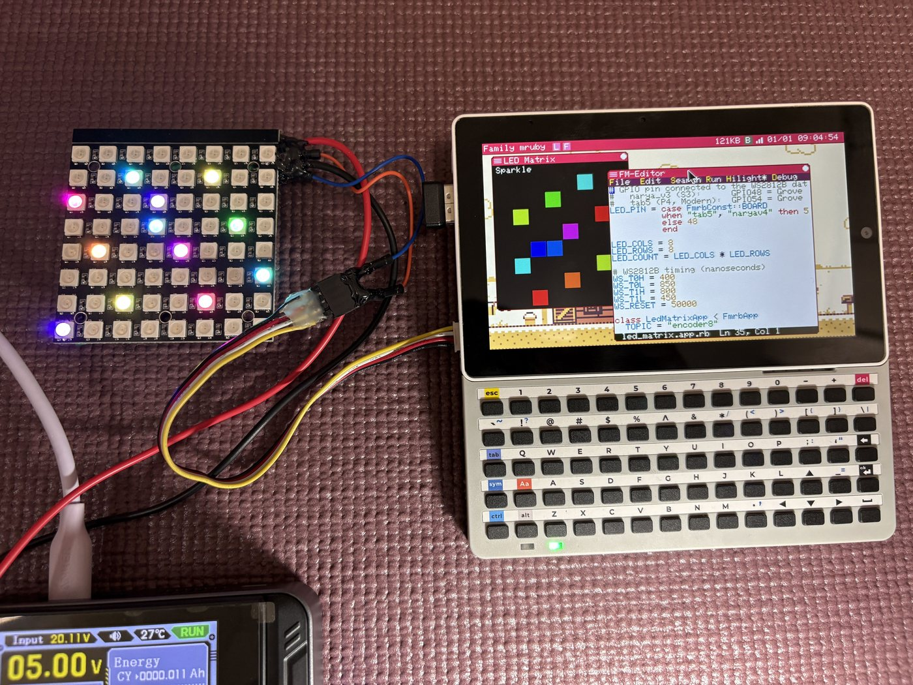

# ハードウェア制御 (GPIO / I2C / UART / RMT / RTC)

ハードウェア周辺機器を Ruby から操作するための API です。

!!! note
    各端子のピン配置・電気的仕様は [ハードウェア](../hardware.md) を参照してください。  
    ピンが他の機能で使われていないかは [`FmrbHw.pin_status`](const.md#fmrbhw) で確認できます。

!!! warning "ピン番号は機種で違います"
    GROVE のピンは Retro と Modern で違うので、番号を決め打ちしたアプリは片方でしか
    動きません。基板で分岐してください。

    ```ruby
    sda, scl = case FmrbConst::BOARD
               when "tab5", "naryav4" then [53, 54]   # Tab5 の GROVE
               else                        [47, 48]   # narya-board の GROVE 2
               end
    ```

    システムが確保していて、そもそも取得できないピンもあります。機種ごとの一覧は
    [ハードウェア](../hardware.md) を参照してください。

## GPIO

デジタル入出力です。

### コンストラクタ

```ruby
GPIO.new(pin, flags, alt_function = 0)
```

| 引数 | 用途 |
|---|---|
| `pin` | GPIO 番号 |
| `flags` | 方向・プル設定（OR で組み合わせ可） |
| `alt_function` | 代替機能番号（通常 `0`） |

### `flags` 定数

| 定数 | 意味 |
|---|---|
| `GPIO::IN` | 入力 |
| `GPIO::OUT` | 出力 |
| `GPIO::HIGH_Z` | ハイインピーダンス |
| `GPIO::PULL_UP` | プルアップ抵抗有効 |
| `GPIO::PULL_DOWN` | プルダウン抵抗有効 |
| `GPIO::OPEN_DRAIN` | オープンドレイン出力 |
| `GPIO::ALT` | 代替機能 |

OR で組み合わせます:

```ruby
btn = GPIO.new(10, GPIO::IN | GPIO::PULL_UP)
led = GPIO.new(11, GPIO::OUT)
```

### インスタンスメソッド

| メソッド | 用途 |
|---|---|
| `read` | レベル読み出し（`0` / `1`） |
| `write(val)` | `0` または `1` を出力 |
| `high?` | レベルが High なら `true` |
| `low?` | レベルが Low なら `true` |

### クラスメソッド（インスタンスを作らずダイレクト操作）

| メソッド | 用途 |
|---|---|
| `GPIO.read_at(pin)` | レベル読み出し |
| `GPIO.write_at(pin, val)` | レベル出力 |
| `GPIO.high_at?(pin)` / `GPIO.low_at?(pin)` | レベル判定 |
| `GPIO.set_dir_at(pin, dir)` | 方向のみ変更 |
| `GPIO.pull_up_at(pin)` / `GPIO.pull_down_at(pin)` | プル抵抗を有効化 |
| `GPIO.open_drain_at(pin)` | オープンドレイン |
| `GPIO.set_function_at(pin, alt)` | 代替機能 |

### サンプル: ボタンで LED トグル

```ruby
class LedToggle < FmrbApp
  BTN_PIN = 10
  LED_PIN = 11

  def on_create
    @btn = GPIO.new(BTN_PIN, GPIO::IN | GPIO::PULL_UP)
    @led = GPIO.new(LED_PIN, GPIO::OUT)
    @led.write(0)
    @prev = 1
  end

  def on_update
    cur = @btn.read
    if @prev == 1 && cur == 0   # 立ち下がり
      @led.write(@led.read == 1 ? 0 : 1)
    end
    @prev = cur
    20
  end
end
```

## I2C

I2C バス経由でデバイスと通信します。

### コンストラクタ

```ruby
I2C.new(unit:, frequency: 100_000, sda_pin: -1, scl_pin: -1, timeout: 500)
```

| 引数 | 用途 |
|---|---|
| `unit:` | バス識別子。例: `"ESP32_I2C0"`、`"ESP32_I2C1"` |
| `frequency:` | クロック周波数 (Hz)。デフォルト 100kHz |
| `sda_pin:` / `scl_pin:` | -1 で既定ピンを使用 |
| `timeout:` | タイムアウト ms |

### メソッド

| メソッド | 用途 |
|---|---|
| `read(addr_7bit, length, timeout: @timeout, *write_data)` | リード（`write_data` があれば事前ライト → STOP なしでリード） |
| `write(addr_7bit, *data, timeout: @timeout)` | ライト。`Integer` / `Array<Integer>` / `String` を受け付け |
| `scan(timeout: @timeout)` | 0x08〜0x77 をスキャンして応答デバイス一覧を返す |
| `close` | バス解放 |

### サンプル: I2C デバイスのスキャン

```ruby
i2c = I2C.new(unit: "ESP32_I2C0", frequency: 400_000)
addrs = i2c.scan
Log.info("found: #{addrs.map { |a| a.to_s(16) }.join(', ')}")
```

### サンプル: レジスタ読み書き

```ruby
i2c = I2C.new(unit: "ESP32_I2C0")
# レジスタ 0x10 から 4 バイト読み出し
data = i2c.read(0x32, 4, 0x10)   # 第3引数以降が write_data
i2c.write(0x32, 0x10, 0xAB)      # 0x10 = 0xAB を書き込み
```

## RMT

ESP32 の RMT ペリフェラル経由で WS2812B / WS2812 LED や赤外線リモコンを駆動します。

### コンストラクタ

```ruby
RMT.new(pin, t0h_ns:, t0l_ns:, t1h_ns:, t1l_ns:, reset_ns:)
```

NRZ 符号化のタイミング（ナノ秒）を指定します。WS2812B の標準値:

```ruby
rmt = RMT.new(8,
              t0h_ns: 350,  t0l_ns: 900,
              t1h_ns: 700,  t1l_ns: 600,
              reset_ns: 50_000)
```

### メソッド

| メソッド | 用途 |
|---|---|
| `write(*params)` | バイト列出力。`Integer` / `Array` / `String` 引数対応 |

### サンプル: WS2812B を点灯

```ruby
class LedStrip < FmrbApp
  RMT_PIN = 8

  def on_create
    @rmt = RMT.new(RMT_PIN,
                    t0h_ns: 350,  t0l_ns: 900,
                    t1h_ns: 700,  t1l_ns: 600,
                    reset_ns: 50_000)
    set_color(0xFF, 0x00, 0x00)  # 赤
  end

  def set_color(r, g, b)
    # WS2812B は GRB 順
    @rmt.write([g, r, b])
  end
end
```

`/app/demo/led_matrix.app.rb` に WS2812B マトリクスのサンプルがあります。



このアプリはパネルに送るのと同じ模様を画面にも描くので、何もつないでいなくても
動きが分かります。ソースの先頭近くにある `LED_PIN` の `FmrbConst::BOARD` による
分岐にも注目してください。GROVE のピンは機種で違います。

## 時計 (RX8900 / RX8130)

両機種とも I2C の `0x32` に電池つきの RTC を持っています。部品は違います。

| 機種 | 部品 | クラス |
|---|---|---|
| Retro (narya-board) | RX8900。I2C1 上で GROVE 1 と共有 | `RX8900` |
| Modern (M5Stack Tab5) | RX8130。内部のバスに接続 | `RX8130` |

2 つのクラスは引数もメソッドも同じなので、基板でクラスを選べば同じアプリが両方で動きます。

```ruby
i2c = I2C.new(unit: "ESP32_I2C0")
rtc = FmrbConst::BOARD == "tab5" ? RX8130.new(i2c) : RX8900.new(i2c)
rtc.sync_system_clock
```

### メソッド

| メソッド | 戻り値 / 用途 |
|---|---|
| `init` | RTC の初期化 |
| `read_time` | `{year:, month:, day:, hour:, minute:, second:, wday:}` |
| `write_time(hash)` | 時刻を書き込む |
| `sync_system_clock` | RTC からシステム時計を合わせる。成功なら `true` |
| `vlf?` | 電圧低下フラグ。`true` なら保持していた時刻が失われた可能性があります |
| `temperature` | 摂氏の温度 (`Float`)。RX8900 のみ |

### サンプル: 起動時に時計を合わせる

```ruby
class ClockSyncApp < FmrbApp
  def on_create
    i2c = I2C.new(unit: "ESP32_I2C0")
    rtc = FmrbConst::BOARD == "tab5" ? RX8130.new(i2c) : RX8900.new(i2c)
    if rtc.vlf?
      Log.warn("RTC battery low; resetting")
      rtc.write_time(year: 2026, month: 1, day: 1,
                     hour: 0, minute: 0, second: 0, wday: 4)
    end
    rtc.sync_system_clock
    now = rtc.read_time
    Log.info("time: #{now[:year]}-#{now[:month]}-#{now[:day]} #{now[:hour]}:#{now[:minute]}")
  end
end
```

!!! note "普段は使わなくて済みます"
    システムは起動時に RTC から時刻を取り込みますし、`FmrbApp.wallclock` /
    `FmrbSystem.set_wallclock` はシステム時計 (POSIX epoch) 経由で RTC にも書き戻します。
    このクラスを直接使うのは、電圧低下フラグや RX8900 の温度センサなど、部品自身の機能が
    要るときだけです。

## 6 軸センサ (BMI270、Modern のみ)

Modern は内部の I2C バスに BMI270 (加速度計とジャイロ) を載せています。このバスは表示の
ドライバが直列化してくれるので、普通の `I2C` を作るだけで使えます。

```ruby
i2c = I2C.new(unit: :ESP32_I2C1,
              sda_pin: FmrbHw::PIN_I2C1_SDA,
              scl_pin: FmrbHw::PIN_I2C1_SCL)
imu = BMI270.new(i2c)
if imu.probe && imu.init
  a = imu.read_accel     # {x:, y:, z:}、単位は g
  g = imu.read_gyro      # {x:, y:, z:}、単位は度/秒
end
```

| メソッド | 戻り値・用途 |
|---|---|
| `BMI270.new(i2c, addr = nil)` | アドレスを渡さなければ `0x68` と `0x69` から探します |
| `probe` | 応答があったか |
| `init(config_path = "/usr/share/imu/bmi270_config.bin")` | センサの設定データを書き込みます。電源投入後に 1 回必要で、少し時間がかかります |
| `ready?` | 設定が通ったか |
| `read_accel` | 加速度。`{x:, y:, z:}`、単位は g |
| `read_gyro` | 角速度。`{x:, y:, z:}`、単位は度/秒 |
| `read_raw` | 両方を 16bit の生の値で。`{ax:, ay:, az:, gx:, gy:, gz:}` |
| `read_temperature` | 摂氏 |
| `address` / `error` | 見つけたアドレスと、直前の失敗の理由 |

同梱の 6 軸センサアプリ (`/app/modern/imu.app.rb`) が手本です。部品の無い基板では作り物の
傾きで描き続け、その旨を状態行に出します。

## UART (シリアル)

端子につないだシリアルの機器 (LoRa の無線・GPS・ほかのマイコンなど) と、アプリから文字やバイトをやりとりできます。
試すだけなら、メニューの **シリアルターミナル** で番号とピンと速さを選んで Open を押し、下の欄に打った 1 行を Enter で
送れます。届いた文字は真ん中に並びます。(Family mruby 3.1.0 から)

### つなぎ方

- **TX と RX は相手と交差させます**: こちらの TX を相手の RX に、こちらの RX を相手の TX につなぎます。
- **GND を必ずつなぎます** (2 台の基準をそろえるため)。
- 信号は **3.3 V** です。5 V の信号の機器を直接つなぐと端末を壊すことがあるので、レベル変換を挟んでください。
- 速さ (ボー) は相手と同じにします。よく使うのは 9600 と 115200 です。

### 機種ごとの番号と端子

番号は UART の番号 (UART1 なら 1) です。下の表の端子は例で、ほかの空いているピンも選べます。

| 機種 | アプリが開ける番号 | 端子の例 (TX・RX) |
|---|---|---|
| Tab5 | 1・2・3・4 | Grove の G53・G54 |
| NARYA v4 (P4-Nano) | 1・2・3・4 | 拡張のピンヘッダの空いているピン |
| AtomS3R | 1・2 | Grove の 2・1 |
| StickS3 | 1・2 | Grove の 9・10 |
| NARYA v3 | 2 | GROVE 2 の 47・48 |

- UART0 (コンソール) と、NARYA v3 の UART1 (描画側とのつながり) は本体が使っているので開けません。
- 画面・SD・無線・音などに使っているピンは選べません。理由が出ます。
- Linux のシミュレータでは UART2 だけが開け、書いた物がそのまま届きます。ブラウザ版・PC 版には UART がありません。

### サンプル

```ruby
class Hello < FmrbApp
  def on_create
    # 番号とピンは Tab5 の Grove
    @u = UART.new(unit: 1, txd_pin: 53, rxd_pin: 54, baudrate: 115200)
    @u.puts "hello"
  end

  def on_update
    line = @u.gets       # 待たない
    Log.info(line) if line
    50
  end
end
```

- 読む側 (`gets`・`read`・`getbyte`) は待ちません。まだ届いていなければ nil を返すので、`on_update` の中で毎回呼びます。
  `write`・`puts` は送り終わるまで待ちます。
- API は PicoRuby の `UART` クラスに合わせてあり、`close`・`closed?`・`dropped` を足してあります。
- アプリが終わると、開いた UART は本体が閉じます。
- 開けないときは `IOError` (使用中・本体のピンなど) か `ArgumentError` (番号やピンが無いなど) になり、理由の文が付きます。

### シリアルの MIDI 出力との関係

シリアルの MIDI 出力は UART2 と Grove の 1 本目のピンを使います。MIDI のアプリが出力先を serial にしている間は、その番号と
ピンを UART で開けません ("used by the MIDI serial output")。そのアプリが終わると、また開けます。逆に UART でそのピンを
使っている間は、MIDI の serial 出力が開きません。

### うまくいかないとき

- **何も届かない**: TX と RX が交差しているか、GND をつないだか、速さが相手と同じかを確かめます。
- **文字化けする**: 速さか形式 (データ 8 ビット・パリティ無し・ストップ 1 ビットが普通) が相手と違います。
- **"in use by another app"**: ほかのアプリが同じ番号を開いています。そのアプリを閉じてください。
- **"used by the system"**: 本体が使っている番号かピンです。別のものを選んでください。
- **捨てたバイトが出る** (シリアルターミナルの表示、`dropped`): 読むのが追いついていません。もっと頻繁に読むか、
  `rx_buffer_size:` を大きく (16384 まで) してください。

## ピン割り当て確認

ピンを使う前に、システムが既に使っていないか確認できます。

```ruby
unless FmrbHw.pin_available?(10)
  Log.error("Pin 10 already in use: #{FmrbHw.pin_status(10)}")
  return
end
```

詳細は [FmrbHw](const.md#fmrbhw) を参照。

<!-- BEGIN class reference links (generated by fmruby-core tools/ti/gen_site.rb; do not edit) -->
**クラスリファレンス:** [`GPIO`](reference/GPIO.md)、[`I2C`](reference/I2C.md)、[`UART`](reference/UART.md)、[`FmrbUart`](reference/FmrbUart.md)、[`FmrbHw`](reference/FmrbHw.md)
<!-- END class reference links -->
