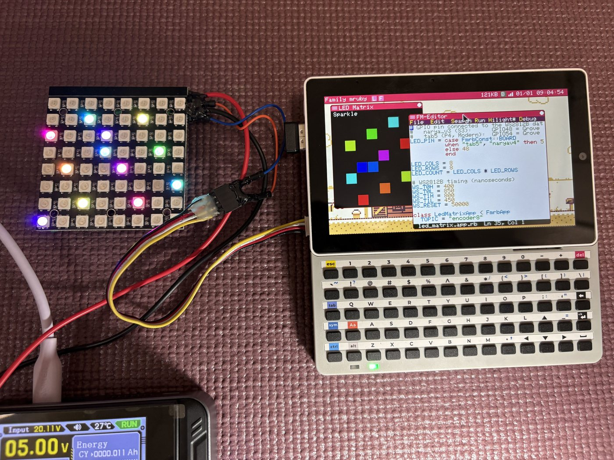

# Hardware Control (GPIO / I2C / UART / RMT / RTC)

APIs for operating hardware peripherals from Ruby.

!!! note
    For pin layouts and electrical specifications, see [Hardware](../hardware.md).
    To check whether a pin is already in use by another function, use [`FmrbHw.pin_status`](const.md#fmrbhw).

!!! warning "Pin numbers differ between the machines"
    The GROVE pins are not the same on Retro and Modern, so an app that hardcodes a number
    runs on one machine only. Branch on the board instead:

    ```ruby
    sda, scl = case FmrbConst::BOARD
               when "tab5", "naryav4" then [53, 54]   # Tab5 GROVE
               else                        [47, 48]   # narya-board GROVE 2
               end
    ```

    Some pins are held by the system and cannot be acquired at all — see
    [Hardware](../hardware.md) for the reserved list on each machine.

## GPIO

Digital input/output.

### Constructor

```ruby
GPIO.new(pin, flags, alt_function = 0)
```

| Argument | Purpose |
|---|---|
| `pin` | GPIO number |
| `flags` | Direction and pull configuration (can be OR-combined) |
| `alt_function` | Alternate function number (normally `0`) |

### `flags` Constants

| Constant | Meaning |
|---|---|
| `GPIO::IN` | Input |
| `GPIO::OUT` | Output |
| `GPIO::HIGH_Z` | High impedance |
| `GPIO::PULL_UP` | Pull-up resistor enabled |
| `GPIO::PULL_DOWN` | Pull-down resistor enabled |
| `GPIO::OPEN_DRAIN` | Open drain output |
| `GPIO::ALT` | Alternate function |

Combine with OR:

```ruby
btn = GPIO.new(10, GPIO::IN | GPIO::PULL_UP)
led = GPIO.new(11, GPIO::OUT)
```

### Instance Methods

| Method | Purpose |
|---|---|
| `read` | Read the level (`0` / `1`) |
| `write(val)` | Output `0` or `1` |
| `high?` | Returns `true` if the level is High |
| `low?` | Returns `true` if the level is Low |

### Class Methods (Direct Operation Without Creating an Instance)

| Method | Purpose |
|---|---|
| `GPIO.read_at(pin)` | Read level |
| `GPIO.write_at(pin, val)` | Output level |
| `GPIO.high_at?(pin)` / `GPIO.low_at?(pin)` | Level check |
| `GPIO.set_dir_at(pin, dir)` | Change direction only |
| `GPIO.pull_up_at(pin)` / `GPIO.pull_down_at(pin)` | Enable pull resistor |
| `GPIO.open_drain_at(pin)` | Open drain |
| `GPIO.set_function_at(pin, alt)` | Alternate function |

### Example: Toggle LED with a Button

```ruby
class LedToggle < FmrbApp
  BTN_PIN = 10
  LED_PIN = 11

  def on_create
    @btn = GPIO.new(BTN_PIN, GPIO::IN | GPIO::PULL_UP)
    @led = GPIO.new(LED_PIN, GPIO::OUT)
    @led.write(0)
    @prev = 1
  end

  def on_update
    cur = @btn.read
    if @prev == 1 && cur == 0   # Falling edge
      @led.write(@led.read == 1 ? 0 : 1)
    end
    @prev = cur
    20
  end
end
```

## I2C

Communicates with devices via the I2C bus.

### Constructor

```ruby
I2C.new(unit:, frequency: 100_000, sda_pin: -1, scl_pin: -1, timeout: 500)
```

| Argument | Purpose |
|---|---|
| `unit:` | Bus identifier. e.g. `"ESP32_I2C0"`, `"ESP32_I2C1"` |
| `frequency:` | Clock frequency (Hz). Default 100kHz |
| `sda_pin:` / `scl_pin:` | -1 uses the default pins |
| `timeout:` | Timeout in ms |

### Methods

| Method | Purpose |
|---|---|
| `read(addr_7bit, length, timeout: @timeout, *write_data)` | Read (`write_data` triggers a write first, then read without STOP) |
| `write(addr_7bit, *data, timeout: @timeout)` | Write. Accepts `Integer` / `Array<Integer>` / `String` |
| `scan(timeout: @timeout)` | Scan addresses 0x08 to 0x77 and return a list of responding devices |
| `close` | Release the bus |

### Example: Scanning I2C Devices

```ruby
i2c = I2C.new(unit: "ESP32_I2C0", frequency: 400_000)
addrs = i2c.scan
Log.info("found: #{addrs.map { |a| a.to_s(16) }.join(', ')}")
```

### Example: Register Read/Write

```ruby
i2c = I2C.new(unit: "ESP32_I2C0")
# Read 4 bytes starting from register 0x10
data = i2c.read(0x32, 4, 0x10)   # Arguments after the 2nd are write_data
i2c.write(0x32, 0x10, 0xAB)      # Write 0xAB to register 0x10
```

## RMT

Drives WS2812B / WS2812 LEDs and infrared remotes via the ESP32 RMT peripheral.

### Constructor

```ruby
RMT.new(pin, t0h_ns:, t0l_ns:, t1h_ns:, t1l_ns:, reset_ns:)
```

Specifies NRZ encoding timing in nanoseconds. Standard values for WS2812B:

```ruby
rmt = RMT.new(8,
              t0h_ns: 350,  t0l_ns: 900,
              t1h_ns: 700,  t1l_ns: 600,
              reset_ns: 50_000)
```

### Methods

| Method | Purpose |
|---|---|
| `write(*params)` | Output byte sequence. Accepts `Integer` / `Array` / `String` arguments |

### Example: Lighting WS2812B LEDs

```ruby
class LedStrip < FmrbApp
  RMT_PIN = 8

  def on_create
    @rmt = RMT.new(RMT_PIN,
                    t0h_ns: 350,  t0l_ns: 900,
                    t1h_ns: 700,  t1l_ns: 600,
                    reset_ns: 50_000)
    set_color(0xFF, 0x00, 0x00)  # Red
  end

  def set_color(r, g, b)
    # WS2812B uses GRB order
    @rmt.write([g, r, b])
  end
end
```

A WS2812B matrix sample is available in `/app/demo/led_matrix.app.rb`.



The app draws the same pattern on screen as it sends to the panel, so you can see what it
intends to do even with nothing wired up. Note the `LED_PIN` branch on `FmrbConst::BOARD`
near the top of the source — the GROVE pins differ between the machines.

## Real-Time Clock (RX8900 / RX8130)

Both machines carry a battery-backed RTC on the I2C bus, at address `0x32`. The part differs:

| Machine | Part | Class |
|---|---|---|
| Retro (narya-board) | RX8900, on I2C1, shared with GROVE 1 | `RX8900` |
| Modern (M5Stack Tab5) | RX8130, on the internal bus | `RX8130` |

The two classes take the same arguments and answer to the same methods, so an app that picks
the class by board runs on either:

```ruby
i2c = I2C.new(unit: "ESP32_I2C0")
rtc = FmrbConst::BOARD == "tab5" ? RX8130.new(i2c) : RX8900.new(i2c)
rtc.sync_system_clock
```

### Methods

| Method | Return value / purpose |
|---|---|
| `init` | Initialise the RTC |
| `read_time` | `{year:, month:, day:, hour:, minute:, second:, wday:}` |
| `write_time(hash)` | Write a time |
| `sync_system_clock` | Set the system clock from the RTC. `true` on success |
| `vlf?` | Low-voltage flag. `true` means the stored time may be lost |
| `temperature` | Temperature in Celsius (`Float`). RX8900 only |

### Example: sync the clock at startup

```ruby
class ClockSyncApp < FmrbApp
  def on_create
    i2c = I2C.new(unit: "ESP32_I2C0")
    rtc = FmrbConst::BOARD == "tab5" ? RX8130.new(i2c) : RX8900.new(i2c)
    if rtc.vlf?
      Log.warn("RTC battery low; resetting")
      rtc.write_time(year: 2026, month: 1, day: 1,
                     hour: 0, minute: 0, second: 0, wday: 4)
    end
    rtc.sync_system_clock
    now = rtc.read_time
    Log.info("time: #{now[:year]}-#{now[:month]}-#{now[:day]} #{now[:hour]}:#{now[:minute]}")
  end
end
```

!!! note "You usually do not need this"
    The system syncs from the RTC at boot, and `FmrbApp.wallclock` /
    `FmrbSystem.set_wallclock` go through the system clock (POSIX epoch), which also writes
    back to the RTC. Reach for the driver classes only when you want the chip's own
    features — the low-voltage flag, or the RX8900's temperature sensor.

## Six-Axis Sensor (BMI270, Modern only)

Modern carries a BMI270 accelerometer and gyroscope on its internal I2C bus, which the
display driver serialises — so an ordinary `I2C` instance is all it takes.

```ruby
i2c = I2C.new(unit: :ESP32_I2C1,
              sda_pin: FmrbHw::PIN_I2C1_SDA,
              scl_pin: FmrbHw::PIN_I2C1_SCL)
imu = BMI270.new(i2c)
if imu.probe && imu.init
  a = imu.read_accel     # {x:, y:, z:} in g
  g = imu.read_gyro      # {x:, y:, z:} in degrees per second
end
```

| Method | Return value / purpose |
|---|---|
| `BMI270.new(i2c, addr = nil)` | The address is found among `0x68` and `0x69` when not given |
| `probe` | Whether the part answered |
| `init(config_path = "/usr/share/imu/bmi270_config.bin")` | Upload the sensor's configuration blob. It has to be done once after power-on, and takes a moment |
| `ready?` | Whether the configuration took |
| `read_accel` | Acceleration, `{x:, y:, z:}` in g |
| `read_gyro` | Angular rate, `{x:, y:, z:}` in degrees per second |
| `read_raw` | Both, as raw 16-bit counts: `{ax:, ay:, az:, gx:, gy:, gz:}` |
| `read_temperature` | Degrees Celsius |
| `address` / `error` | The address it found, and why the last step failed |

The bundled IMU app (`/app/modern/imu.app.rb`) is the worked example: it keeps drawing with
a synthetic tilt on a board without the part, and says so on its status line.

## UART (serial)

Apps can exchange text and bytes with a serial device wired to the board's pins (a LoRa radio, a GPS, another
microcontroller ...). To just try it, open **Serial Terminal** from the menu, pick the unit, the pins and the speed,
press Open, then type a line in the box at the bottom and press Enter to send it. What arrives is listed in the
middle. (Family mruby 3.1.0 or later.)

### Wiring

- **Cross TX and RX**: our TX goes to the other side's RX, our RX to its TX.
- **Always connect GND**, so both sides share the same reference.
- The signals are **3.3 V**. A device with 5 V signals can damage the board when wired directly: put a level shifter
  in between.
- Use the same speed (baud rate) on both sides. 9600 and 115200 are common.

### Units and pins per board

A unit is the UART's number (1 for UART1). The pins in the table are examples; other free pins can be chosen too.

| Board | Units an app may open | Example pins (TX, RX) |
|---|---|---|
| Tab5 | 1, 2, 3, 4 | the Grove port, G53 and G54 |
| NARYA v4 (P4-Nano) | 1, 2, 3, 4 | free pins of the expansion header |
| AtomS3R | 1, 2 | Grove, 2 and 1 |
| StickS3 | 1, 2 | Grove, 9 and 10 |
| NARYA v3 | 2 | GROVE 2, 47 and 48 |

- UART0 (the console) and NARYA v3's UART1 (the link to the drawing side) are the system's and cannot be opened.
- Pins used for the screen, the SD card, the radio, sound and the like cannot be chosen; you are told why.
- On the Linux simulator only UART2 opens, and what you write comes straight back. The browser and the PC builds
  have no UART.

### Example

```ruby
class Hello < FmrbApp
  def on_create
    # unit and pins: the Tab5's Grove port
    @u = UART.new(unit: 1, txd_pin: 53, rxd_pin: 54, baudrate: 115200)
    @u.puts "hello"
  end

  def on_update
    line = @u.gets       # never waits
    Log.info(line) if line
    50
  end
end
```

- Reading (`gets`, `read`, `getbyte`) never waits: it gives nil until something has arrived, so call it in every
  `on_update`. `write` and `puts` wait until the bytes are sent.
- The API follows PicoRuby's `UART` class; `close`, `closed?` and `dropped` are added.
- When the app ends, the system closes the UARTs it opened.
- When it cannot be opened you get an `IOError` (in use, a system pin ...) or an `ArgumentError` (no such unit or
  pin ...), with the reason in the message.

### With the serial MIDI output

The serial MIDI output uses UART2 and the first pin of the Grove port. While a MIDI app sends to "serial", that unit
and pin cannot be opened as a UART ("used by the MIDI serial output"); they are free again once that app ends. The
other way round, while a UART uses those pins, the serial MIDI output does not open.

### When it does not work

- **Nothing arrives**: check that TX and RX are crossed, GND is connected and the speed is the same on both sides.
- **Garbled characters**: the speed or the format differs from the other side (8 data bits, no parity, 1 stop bit is
  the usual one).
- **"in use by another app"**: another app has the same unit open. Close it.
- **"used by the system"**: a unit or pin the system uses. Pick another one.
- **Dropped bytes** (Serial Terminal's counter, `dropped`): reading does not keep up. Read more often, or give a
  larger `rx_buffer_size:` (up to 16384).

## Pin Assignment Check

Before using a pin, you can check whether the system is already using it.

```ruby
unless FmrbHw.pin_available?(10)
  Log.error("Pin 10 already in use: #{FmrbHw.pin_status(10)}")
  return
end
```

For details, see [FmrbHw](const.md#fmrbhw).

<!-- BEGIN class reference links (generated by fmruby-core tools/ti/gen_site.rb; do not edit) -->
**Class reference:** [`GPIO`](reference/GPIO.md), [`I2C`](reference/I2C.md), [`UART`](reference/UART.md), [`FmrbUart`](reference/FmrbUart.md), [`FmrbHw`](reference/FmrbHw.md)
<!-- END class reference links -->
