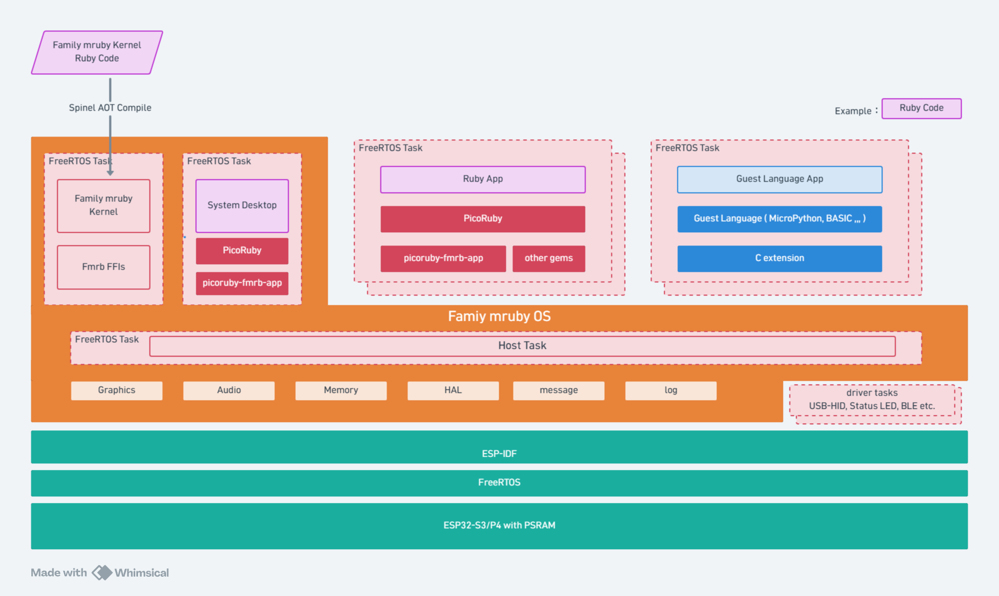

# アーキテクチャ

Family mruby は、FreeRTOS の上に載った小さな多 VM オペレーティングシステムです。複数の
スクリプト VM が並んで動き、FreeRTOS のタスク 1 つに VM 1 つ、それぞれが自分のヒープを
持ちます。だから 1 つのアプリがメモリを使い切っても、落ちても、システム全体は道連れに
なりません。



## タスク 1 つに VM 1 つ

設計の原則は 1 タスク = 1 VM です。各 VM は自分のスタック、自分のメモリ領域、自分の
確保用ハンドルを持ちます。この隔離があるから、書きかけのプログラムをデスクトップの隣で
動かしても安全です。

| | |
|---|---|
| ユーザアプリの枠 | Modern・Linux 版・Studio は 5 つ (`max_apps` で下げられます)。ESP32-S3 の端末 (Retro・StickS3・AtomS3R) は同時に 3 つまで |
| アプリ 1 つあたりのヒープ | 機種によります。下の表を参照 |
| 言語 | Ruby (PicoRuby)、MicroPython、BASIC、Lua。[WebAssembly のアプリ](wasm_apps.md) として WAMR の上で C・TinyGo・Rust・Zig (ESP32-S3 の基板を除く。開発版) |

| 機種 | 通常のプール | `large_memory = 1` |
|---|---|---|
| Retro・StickS3・AtomS3R (ESP32-S3) | 500KB | 1MB |
| Modern (ESP32-P4) | 1MB | 2MB |
| Linux のシミュレータと Linux 版 (64 ビット) | 1.5MB | 3MB |
| Studio (WebAssembly、32 ビット) | 1.5MB | 3MB |

プールは伸びません。アプリのオブジェクトも、ソースをコンパイルするときの作業領域も、
`require` したファイルの中身もここから取ります。割り当てが失敗するのは合計が尽きたときだけ
ではなく、求めた大きさの連続した空きが 1 つも無いときです。Linux の 2 つは 64 ビットなので
同じスクリプトがおよそ 1.5 倍の場所を取り、プールが大きい分で Modern とほぼ同じ厳しさに
なります。Studio は 32 ビットのまま同じ大きさのプールを持つので実機より緩く、Studio で動いた
アプリが実機で動くとは限りません。

領域を分けているのは整理のためだけではありません。メモリの断片化は原因となったアプリの
中に留まり、アプリが終わればその領域はまるごと回収されます。

Modern・Linux 版・ブラウザ版では、通常のプールが枠ごとに 1 つあります。先頭の 3 つは
起動時に確保し、残りはそこにアプリが入った時点で PSRAM から取ります。`large_memory` の
プールは 1 つしかないので、そのアプリは同時に 1 本だけです。要らないアプリは求めないで
ください。

ESP32-S3 の端末のプールは、起動時に確保する 3 つ (通常 1 つと大きい方 2 つ) だけです。
通常のアプリは通常のプールを、ふさがっていれば空いている大きい方を取り、`large_memory` の
アプリは大きい方を取ります。4 本目は「No free app slot」で断られます。Asterism を使う間は、
その転送のアプリが大きい方を 1 つ持ちます。

自分のアプリとして常駐させると割に合わない仕事 — 時計、ネットワークの見張り、読み上げ —
は、[サービスホスト](file_formats/services.md)という 1 つの VM を分け合います。小さな仕事が
12 個あっても、タスクと枠は 1 つずつで済みます。

## カーネルは「コンパイルされた Ruby」

カーネルとデスクトップは Ruby で書かれていますが、解釈実行ではありません。同じソースを
別の方式で機械語に事前コンパイルしています。VM で動かしていたときと比べて、入力の遅れが
大きく減りました。公開しているファームウェアはこの形で作っています。解釈実行の構成も
残してあり、両者を突き合わせて確認しています。

利用者が書くアプリは、これまでどおり PicoRuby の VM で動きます。コンパイルされるのは
システム自身の Ruby だけです。

## ハードウェアの形は 2 つ

同じ OS が、まったく違う 2 つの構成で動きます。画面の無い小型機 (StickS3・AtomS3R) は
Retro の構成の ESP32-S3 だけを使い、自前の小さな液晶を持ち、デスクトップはありません。
開発中の NARYA v4 ボードは、Modern の構成を HDMI 出力の ESP32-P4 モジュールに載せたものです。

### Modern — 1 個のチップが全部やる

```
ESP32-P4  ── OS、VM、描画、音、入力、USB ホスト
   │
   ├── MIPI-DSI 液晶 (1280x720)。426x240 のバッファを PPA で拡大
   ├── I2S コーデック、APU エミュレータ
   ├── GT911 タッチ、Tab5 Keyboard (I2C)、USB HID ホスト
   └── ESP32-C6 (SDIO) ── WiFi + BLE
```

描画も音も本体の中で完結します。P4 が自分でバッファを合成し、PPA が液晶の大きさに
拡大します。話しかける相手のチップがいないので、同じ Ruby アプリでも描画が速くなります。

### Retro — 2 個のチップで分担する

```
ESP32-S3 ── OS、VM、入力、USB ホスト、WiFi/BLE
   │
   │  UART, 921600 bps, CTS/RTS フロー制御
   ▼
ESP32-WROVER ── 描画 + 音
   ├── NTSC コンポジット出力 (LovyanGFX CVBS)
   └── ファミコン風 APU エミュレータ、I2S DAC
```

S3 が描画と音の命令をシリアルで送り、WROVER がそれをコンポジット映像と音声にします。
チップは 2 つとも書き込む必要があり、両方の版を揃える必要があります。この間のやりとりが
決められた手順だからです。

## アプリから見えるもの

上のことは何も見えません。描画も音も周辺機器も、両機種で同じ呼び方です。片方ではその
呼び出しが手元の描画部に渡り、もう片方では UART に載って送られる、という違いだけです。
画面の大きさを決め打ちせず、配線を `FmrbConst::BOARD` で分けておけば、同じアプリが
どちらでもそのまま動きます。

ハードウェアはシステム側が持ち、GPIO・I2C・RMT・ファイルは代理を通して使います。だから
複数の VM が同じバスを取り合わずに使えます。

## 開発の対象

同じソースから次のビルドが出ます。

| 対象 | 内容 |
|---|---|
| `esp32` / Modern | ESP32-P4 (M5Stack Tab5。開発中の NARYA v4 ボード) |
| `esp32` / Retro | ESP32-S3 + ESP32-WROVER (narya-board) |
| `esp32` / Headless | ESP32-S3 単体 (M5Stack StickS3・AtomS3R)。アプリ 1 つで、デスクトップは無し |
| `linux` | システム全体を Linux のプロセスとして動かします。画面は SDL2。[シミュレータ](getting_started/simulator.md) を参照 |
| Linux 版 | 同じシステムを、ESP-IDF を使わない普通のプログラムとして Linux のパソコンで動かします。自分のウィンドウで動くほか、セッション全体のコンポジタにもなります。各リリースに `.deb` で添付 |
| `wasm` | 同じシステムを WebAssembly にしたもの。FreeRTOS を協調的に移植し、ブラウザのタブで動きます。[Studio](getting_started/studio.md) を参照 |

Linux 版は模擬品ではありません。本物のカーネル、本物のデスクトップ、本物のアプリが動き、
下のドライバだけが差し替わっています。作業の大半は実機に触れる前にここで済みます。

## 関連

- [ハードウェア](hardware.md) — 基板の詳細
- [機種の選択](getting_started/choose_hardware.md)
- [制約事項](limitations.md) — どこに限界があるか
