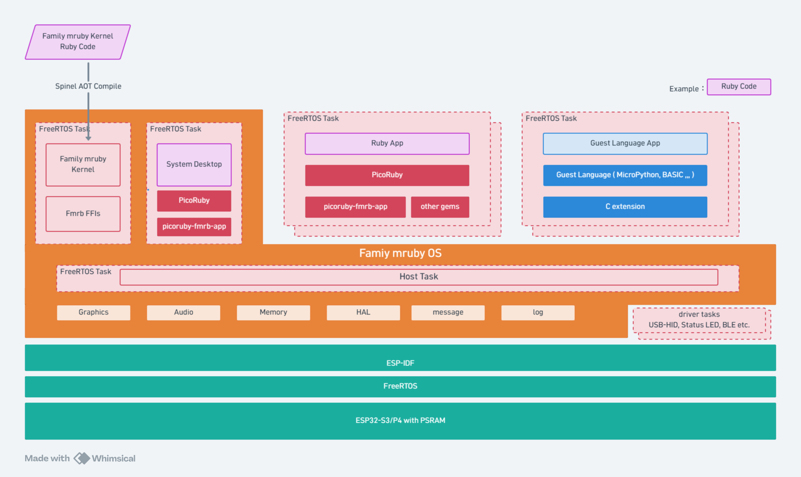

# Architecture

Family mruby is a small multi-VM operating system on top of FreeRTOS. Several scripting VMs
run side by side, one per FreeRTOS task, each with its own heap — so one app running out of
memory or crashing does not take the system with it.



## One task, one VM

The design rule is one task = one VM. Each VM has its own stack, its own memory pool and
its own allocator handle. That isolation is what makes it safe to let a user's half-finished
program run next to the desktop.

| | |
|---|---|
| User app slots | 5 on Modern, the Linux builds and Studio (`max_apps` can lower it). 3 at a time on the ESP32-S3 boards (Retro, StickS3, AtomS3R) |
| Heap per app | Depends on the machine — see the table below |
| Languages | Ruby (PicoRuby), MicroPython, BASIC, Lua; and, as [WebAssembly apps](languages/wasm.md) on WAMR, C, TinyGo, Rust and Zig (not on the ESP32-S3 boards; development version) |

| Machine | Ordinary pool | With `large_memory = 1` |
|---|---|---|
| Retro, StickS3, AtomS3R (ESP32-S3) | 500 KB | 1 MB |
| Modern (ESP32-P4) | 1 MB | 2 MB |
| Linux simulator and Linux program (64-bit) | 1.5 MB | 3 MB |
| Studio (WebAssembly, 32-bit) | 1.5 MB | 3 MB |

The pool does not grow. Everything the app has — its objects, the compiler working on its
source, the files it `require`s — comes out of it, and an allocation fails when no single
free block is large enough, not only when the total runs out. The Linux builds are 64-bit,
so the same script takes about one and a half times the room there; the larger pool makes
them about as tight as Modern. Studio is 32-bit with the same larger pool, so it is looser
than a board: an app that fits in Studio may not fit on a board.

A separate pool is not just tidiness: memory fragmentation stays inside the app that caused
it, and when an app dies its whole pool is reclaimed at once.

On Modern and the Linux and browser builds each slot has its own ordinary pool: the first
three are reserved when the system starts and the rest are taken from PSRAM the first time
an app lands in them. There is only one `large_memory` pool there, so only one such app
runs at a time, and an app that does not need it should not ask for it.

The ESP32-S3 boards have three pools in all, reserved at boot: one ordinary and two large.
An ordinary app takes the ordinary pool, or a free large one when that is taken; a
`large_memory` app takes a large one. A fourth app is refused with "No free app slot".
While Asterism is in use, its transfer app holds one of the large pools.

Everything resident that would otherwise be an app of its own — the clock, the network
watcher, the thing that reads a sentence out loud — shares a single VM instead, the
[service host](file_formats/services.md). A dozen small jobs then cost one task and one
slot rather than a dozen.

## The kernel is compiled Ruby

  The kernel and the desktop are written in Ruby, but they do not run on an interpreter. They
  are compiled ahead of time to native code — the same source, a different backend — which
  cut input latency substantially compared with running them on the VM. This is how the
  released firmware is built; the interpreted build still exists, and is what the two are
  checked against.

The apps you write still run on the PicoRuby VM. Only the system's own Ruby is compiled.

## Two hardware shapes

The same OS runs on two very different arrangements. The headless boards (StickS3,
AtomS3R) are the Retro arrangement's ESP32-S3 on its own, with a small LCD of their own and
no desktop; the NARYA v4 board under development is the Modern arrangement on an
ESP32-P4 module with HDMI out.

### Modern — one chip does everything

```
ESP32-P4  ── OS, VMs, graphics, sound, input, USB host
   │
   ├── MIPI-DSI panel (1280x720), PPA scaling from a 426x240 framebuffer
   ├── I2S codec, APU emulator
   ├── GT911 touch, Tab5 Keyboard (I2C), USB HID host
   └── ESP32-C6 (SDIO) ── Wi-Fi + BLE
```

Graphics and audio are local: the P4 composites the framebuffer itself and its PPA block
scales it onto the panel. There is no second processor to talk to, which is why the same
Ruby app is quicker to draw here.

### Retro — the work is split across two chips

```
ESP32-S3 ── OS, VMs, input, USB host, Wi-Fi/BLE
   │
   │  UART, 921600 bps, CTS/RTS flow control
   ▼
ESP32-WROVER ── graphics + audio
   ├── NTSC composite out (LovyanGFX CVBS)
   └── NES APU emulator, I2S DAC
```

The S3 sends drawing and sound commands over a serial link; the WROVER turns them into a
composite video signal and audio. Both chips have to be flashed, and both have to be on the
same version, because that link is a protocol.

## What the app sees

Nothing of the above. The graphics API, the audio API and the peripheral API are the same
calls on both machines — one path submits them to a local renderer, the other serialises
them onto a UART. An app that avoids hardcoding the screen size and branches on
`FmrbConst::BOARD` for wiring runs unchanged on either.

Hardware is owned by the system and reached through a proxy (GPIO, I2C, RMT, files), so
several VMs can use the same bus without fighting over it.

## Development targets

These builds come out of the same source tree:

| Target | What it is |
|---|---|
| `esp32` / Modern | ESP32-P4 (M5Stack Tab5; the NARYA v4 board, in development) |
| `esp32` / Retro | ESP32-S3 + ESP32-WROVER (narya-board) |
| `esp32` / Headless | ESP32-S3 on its own (M5Stack StickS3, AtomS3R), one app and no desktop |
| `linux` | The whole system as a Linux process, with SDL2 for the screen. See [Simulator](getting_started/simulator.md) |
| Linux program | The same system as one ordinary program on a Linux PC, without ESP-IDF underneath: its own window, or the whole session as the compositor. Shipped as a `.deb` with each release |
| `wasm` | The same system compiled to WebAssembly, with a cooperative FreeRTOS port, running in a browser tab. See [Studio](getting_started/studio.md) |

The Linux build is not a mock: it runs the real kernel, the real desktop and the real apps,
with the drivers swapped underneath. Most work can be done there before touching hardware.

## Related

- [Hardware](hardware.md) — the boards in detail
- [Choose your hardware](getting_started/choose_hardware.md)
- [Limitations](limitations.md) — where the edges are
