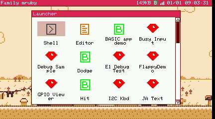
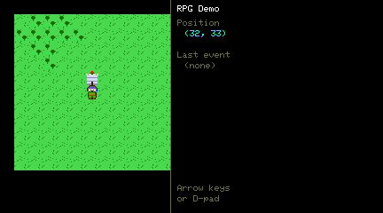
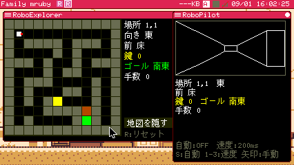
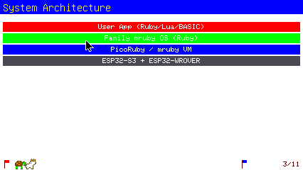

# Default Apps

Everything below ships on the device. Open the Launcher from the system menu (or press
`L` on the desktop) and double-click an icon.

  

!!! tip "The list is built at boot"
    The launcher scans for apps once, when the desktop starts. After you add a file,
    press the **Reload** button in the launcher's title bar (or `F5`) to rescan.

A few apps also sit on the desktop itself as icons — see
[The Desktop](desktop.md#icons-on-the-desktop).

Apps live under `/app`, grouped into directories. What follows is grouped the same way.
The samples, sprites, sounds and slide decks they read live under `/usr/share`; anything
you write belongs in [`/home`](../api/filesystem.md#home-is-yours).

## Always there

The grid opens with three the firmware carries itself — Shell, Editor and the App
Store — and the rest are the system's own apps, reachable from the system menu or by
pressing a letter on the desktop.

| App | Key | What it does |
|---|---|---|
| Launcher | `L` | The app grid |
| Shell | `S` | A command line ([its commands](shell.md)) |
| Editor | `E` | Write, run (`F5`) and debug your code |
| App Store | | Fetches published apps over Wi-Fi and installs them under `/app/usr` |
| File Manager | | Browse the flash filesystem |
| Log Viewer | | The system log |
| Monitor | | Running tasks, memory and services |
| HID Inspector | `I` | Works out the report layout of a misbehaving USB mouse and writes it to [`/etc/hid_devices.toml`](../file_formats/hid_devices.md) |
| NSF Player | `N` | The music player, close enough to hand to want a key of its own |

On Modern a service host also runs in the background, holding the resident
[services](../file_formats/services.md). It has no window; the Monitor lists it.

## Ruby demos — `/app/demo`

| App | What it shows |
|---|---|
| PicoRuby demo | Every drawing, font, sprite, sound and P5 feature the Ruby app framework has, one page at a time. The one to read before writing your own |
| Kamon | Generates Japanese family crests from five motifs with rotational symmetry |
| Piano | One octave of the sound chip, played from the keyboard, with the channel and the sweep on a panel |
| Weather | Fetches a forecast over HTTPS and draws it — the [network API](../api/network.md) end to end |
| MIDI APU | Plays the built-in sound chip through the [MIDI](../api/midi.md) layer, switchable to an external instrument |
| MML | The same tune on the APU or an external instrument, written as MML text and loaded from a file |
| StackChan | A parametric face with expressions and emotes |
| StackChan Remote | The same face, driven over [pub/sub](../api/pubsub.md) |
| PubDemo / SubDemo | A publisher and a subscriber, to run together |
| LED Matrix | Drives a WS2812B matrix from the GROVE port |
| I2C Kbd | Reads an I2C keyboard |
| Avatar | Moku, a small mascot in a [frameless window](../file_formats/app_toml.md#frameless-windows) that lives on the desktop. Drag it anywhere; clicks on its see-through parts go to what is behind |
| Walk Scroller | A walker that takes a step each time a step counter on the [Asterism](../api/network.md#asterism-objects-and-topics-across-machines) network reports one. Not in Retro images |

## Python — `/app/python`

| App | |
|---|---|
| Python demo | The twin of the PicoRuby demo, written in MicroPython: the same pages, the same framework |
| PyBench | What fits in one frame of a Python app — the three costs that decide how a game is written |

## BASIC — `/app/basic`

Programs in [FMRuby BASIC](../other_languages.md), runnable and readable:

| App | |
|---|---|
| BASIC app demo | A BASIC program launched as an ordinary app |
| Shoot | A shooting game |
| Maze | |
| Music | `PLAY` and `BEEP` |

## Lua — `/app/lua`

| App | |
|---|---|
| Lua app demo | The app framework from Lua |

## Games — `/app/game`

| App | |
|---|---|
| RPG Demo | A tile world with smooth scrolling, collisions, BGM and sound effects |
| Raycaster | A Wolfenstein-style first-person demo. Keyboard or gamepad |
| BlockGame | With BGM and sound effects |
| Shooter | Sprites, a diving formation, and a boss between the waves |
| Flappy Demo | The one-button game, with scenery behind it |
| Breakout.py | The Python sample game: sprites, tiles, Japanese text, a tune on the main sound chip and effects on the other |
| Robo Explorer | A maze you cannot play directly. The robot takes no keys — it publishes its state and obeys commands that arrive over [pub/sub](../api/pubsub.md) |
| Robo Pilot | The pilot that drives it. The part you write is `my_pilot.rb`: it gets the keys, a `think` call five times a second, and every result. There is a Python pilot too |
| Hide Jong | A riichi mahjong table, up to four players with CPUs in the other seats. Needs a game host ([asterism-games](https://github.com/ruby-asterism/asterism-games)) on the same Asterism network. Not in Retro images |
| Othello (table) | An othello table on the same game host: two seats and spectators |
| Board | A drawing board everyone at the table draws on together, on the same game host |

  

  
   <em>Robo Explorer and the pilot that drives it, talking over pub/sub</em>

## Tools — `/app/tool`

| App | What it does |
|---|---|
| SMF Player | Plays standard MIDI files, with a file list. Songs are in `/usr/share/sounds/midi` |
| NSF Player | Plays NSF (Famicom sound) files from `/usr/share/sounds/nsf` |
| Sprite Editor | Edits a 16x16 RGB332 tile sheet: load a BMP, pick a tile, edit pixels, save back |
| PicoRabbit+ | Presents a slide deck written in Markdown, fullscreen. It opens on a list of every deck it can find — yours under `/home/slides`, the samples under `/usr/share/samples/slides`, and the SD card — and can write a deck out as one picture per slide |
| GPIO Viewer | Live pin status for every GPIO, colour-coded by what is using it |
| Receiving | Whether this machine accepts files and apps sent from other machines over Asterism, and from whom |
| Welcome | The startup app of the headless boards (StickS3, AtomS3R): the version, the Wi-Fi state and address, and how to go on. Not in the launcher; it opens on the desktop too if you start it by path |

  
   <em>PicoRabbit presenting one of the bundled decks</em>

## Modern only — `/app/modern`

Apps that need hardware only a Modern machine has. They are hidden from the launcher on
Retro.

| App | |
|---|---|
| VideoPlay | Plays a Motion JPEG file in a window, picked with the file selector (the SD card is under `/mnt/sd`) |
| Mic Spectrum | What the microphone hears, as a bar graph. The whole chain is on the machine: the microphone samples, the FFT transforms, the graphics draw. Nothing is recorded and nothing leaves the device |
| IMU | The six-axis sensor as a bubble level, with the raw values beside it |

## Test and diagnostic apps

`/app/debug` and `/app/test` hold apps that exist to exercise or break something on purpose
— an app that raises, one that fails to compile, one that saturates the input queue, MIDI
timing benchmarks, an NTSC colour chart, a network check, SD card and tile-map checks. They
are hidden from the launcher on every machine, but the files are there: run one from the
editor or the shell when a device misbehaves. `/app/test` is in development builds only; the
release images and the public browser build leave it out.

## Machine-specific apps

Most apps run on both machines. A few depend on hardware only one of them has:

| App | Note |
|---|---|
| Mic Spectrum, IMU, VideoPlay | Modern only — the microphone, the six-axis sensor |
| NTSC Test | Retro only — it adjusts the composite video output |
| Weather, Net Test | Need Wi-Fi configured. See [Network](../api/network.md) |
| LED Matrix, I2C Kbd | Need something wired to the GROVE port |

## Related

- [Hello World](hello_world.md) — write your own
- [App Config (.app.toml)](../file_formats/app_toml.md) — how an app gets into the launcher
- [File Associations](../file_formats/associations.md) — which app opens which file
- [Examples](../examples.md) — annotated code
