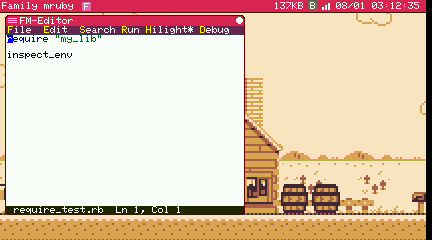
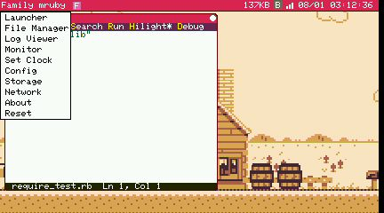
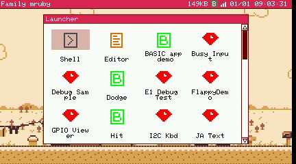

# The Desktop

The desktop is the same on both machines: a menu bar across the top, the wallpaper below it
with a column of app icons, and windows on top of that.

<div align="center">
  
</div>

## The menu bar

Everything the system wants to tell you lives in this 13-pixel strip.

```
┌─────────────────────────────────────────────────────────────────────┐
│ Family mruby  ▪▪       137KB  A  B  ▂▄▆  ◁)  08/07 21:04:11   ⏻    │
└─────────────────────────────────────────────────────────────────────┘
  ↑             ↑        ↑      ↑  ↑  ↑    ↑    ↑               ↑
  |             |        |      |  |  |    |    clock           power
  |             |        |      |  |  |    speaker (mute)
  |             |        |      |  |  Wi-Fi
  |             |        |      |  BLE
  |             |        |      kana
  |             |        RAM
  |             taskbar
  system menu
```

### Family mruby

Click it for the system menu. See [the list below](#the-system-menu).

### Running apps (the taskbar)

Each running app gets a small square, in the order they started, immediately right of the
title. This is the taskbar.

It is a list of windows, not of processes: a square is something you can click to bring to
the front and type into. An app with no window — the service host, for one — has nothing to
raise, so it is not listed. `ps` and the Monitor still show it.

- **The letter** is the first character of the app's name
- **The colour** is the language it runs on:

    | Colour | Language |
    |---|---|
    | Red | Ruby (mruby) |
    | Yellow | MicroPython |
    | Green | BASIC |
    | Blue | Lua |
    | Gray | Native C |

- **A white border** marks the app that currently has keyboard focus
- **Click a square** to bring that app to the front and give it the keyboard

<div align="center">
  
  <br><em>Three apps running. The white border is the one with the keyboard</em>
</div>

An app parked by `Ctrl` + `Tab` (see [below](#switching-between-apps)) stays in the taskbar
while it is frozen, so you can always click your way back to it.

### Free internal RAM

The figure on the right — `137KB` in the example — is free *internal* RAM, not total free
memory. App heaps come from PSRAM, which is plentiful, but each running app also costs about
25 KB of internal RAM, and that is what runs out first. So this is the number that answers
"can I open one more app?".

The Linux simulator has no such limit and shows `---KB`.

<div align="center">
  
  <br><em>The right-hand end, enlarged. Free RAM, kana, BLE, Wi-Fi, clock</em>
</div>

### Kana input

`A` when you are typing ASCII, `あ` for hiragana, `ア` for katakana. Click it to step
through the three. It is there from boot, in every language, because on a keyboard with no
half-width/full-width key — or with no keyboard at all — that click is the way in.
`Ctrl` + `Space` does the same thing from the keyboard.

**Kanji conversion.** On a board with the kanji dictionary on its SD card
(`/sd/dict/fmrb_kanji.dic`), a reading typed in kana mode collects in
a line at the bottom of the screen: `Space` (or the JIS Henkan key) shows candidates and steps
through them, `Enter` or a digit commits, `Esc` goes back. Without the dictionary kana input
works as before. Studio uses the browser's own Japanese input method and the Linux program
the PC's. The guide on the device, `/usr/share/doc/kanji.md`, says where to get the dictionary and how to put it there.

### BLE

| Appearance | Meaning |
|---|---|
| Nothing | BLE is off |
| Gray box, white `B` | BLE is on, waiting for something to connect |
| White box, inverted `B` | A client is connected — the [web console](console.md), typically |

On Retro the system menu starts BLE and `ble_auto_start` in Config decides whether it comes
up at boot; there is no way to stop it again short of a reboot. Modern has the same setting,
and `false` there means nothing is advertised and nothing can connect — the link to the C6
still comes up, because Wi-Fi needs it.

### Wi-Fi

Signal bars, just left of the clock.

| Appearance | Meaning |
|---|---|
| White bars | Connected |
| Gray bars with a red slash | Not connected |
| Nothing | This build has no Wi-Fi |

**Click the bars** to open the Network dialog, which shows the address the device was given.
See [Connecting to Wi-Fi](wifi.md).

### Sound

A speaker just left of the clock. **Click it** to mute the whole machine, and again to
bring the sound back; while muted the cell turns white and the waves become a cross. The
apps keep playing underneath, so nothing is lost. The volume (0-10) is in **Config**, and
both are remembered across a restart. An app reads them with `FmrbApp.audio_muted?` and
`FmrbApp.audio_volume`.

### Clock

Date and time. Set it from Set Clock; the timezone is a separate setting under
**Config**.

### Power

The button at the right end. On a board it holds **Reset** (reboot). In the [Linux program](linux.md#the-power-menu)
it holds what the PC offers: Lock, Suspend, Log Out (or Exit), Restart and Power off, each
asking before it acts. It is not shown where there is nothing to offer (the simulator and
Studio).

## The system menu

<div align="center">
  
</div>

| Item | What it does |
|---|---|
| Launcher | The grid of installed apps |
| Editor | The editor. It is built into the firmware, and heads the launcher grid with the Shell and the App Store |
| File Manager | Browse the flash filesystem |
| Log Viewer | The system log |
| Monitor | Running tasks, memory and [services](../file_formats/services.md); a WASM page for [WebAssembly apps](../languages/wasm.md) |
| Set Clock | Date and time |
| Config | Language, keyboard layout, pointer speed, theme, wallpaper, timezone, volume, Wi-Fi and BLE autostart, display margins |
| Mute / Unmute | The same switch as the speaker in the menu bar |
| Storage | Clear cached files |
| Network | Wi-Fi state, address, hostname, and the [Wi-Fi page](wifi.md) |
| BLE Start | Retro only, and only when BLE did not start at boot |
| BLE Setup | Boards only. Opens a few minutes in which the [web console](console.md) may read and write the Wi-Fi and Asterism settings and the keys; it counts down, and choosing it again closes it |
| Shortcuts | Every key that works here, in one list |
| About | Version and chip information |

Reboot is the power button at the right end of the menu bar.

Whatever Config changes is written back into `/etc/system_conf.toml`, keeping your
comments and other settings intact. On hardware the dialog offers Save & Reboot for the
settings that only take effect at startup.

### What happens before the desktop

Power-on shows the logo the way an old CRT television comes on — a thin line of light in
the middle of the black that stretches sideways and opens up and down into the picture —
over a short chord that rises a fifth and rings, and then the desktop comes up. The whole of
it takes about 1.2 seconds (it took 2.7 in 3.0.0). That ceremony is `boot_splash` in
[`/etc/system_conf.toml`](../file_formats/system_conf.md); setting it to `false` skips both
and saves that time, which is worth having on a
machine built to run one thing. Nothing else changes — the cursor, the status LED and the
startup app all happen either way.

`startup_app` beside it names one app to open as soon as the desktop is ready, by the same
path the launcher uses. Empty means the ordinary desktop. A fullscreen app named there
takes the screen without the desktop showing first. Neither setting is in the Config
dialog: edit the file in the Editor.

## Icons on the desktop

The wallpaper carries a column of icons on the left: the Launcher, the Editor, the Shell,
the File Manager and a few apps (Flappy Demo, the BASIC demo, Breakout, the NSF player) as
shipped. Double-click one to start it; windows sit on top of them. An app that is not on
this machine is skipped.

To change the set, right-click an app in the launcher (or select it and press `D`) and pick
**Add to desktop** or **Remove from desktop**. The choice is written to
`/home/desktop.toml`; delete that file to go back to the default set. In the Linux program
the PC's own applications (a terminal, a browser) can sit there too.

## The launcher

<div align="center">
  
</div>

Double-click an icon to start an app. Arrow keys move the selection and `Enter` starts it.

!!! tip "The list is built once, at boot"
    The launcher scans the filesystem when the desktop starts. After you add an app, press
    the **Reload** button in its title bar (or `F5`) to rescan — otherwise your new app will
    not appear until the next reboot. Right-clicking empty space in the launcher offers
    Reload too.

Right-click an icon (on a Tab5, a two-finger tap), or press `Tab` on the selected one, for
its menu: Add to desktop / Remove from desktop.

## Windows

| Action | How |
|---|---|
| Move | Drag the title bar |
| Focus | Click anywhere in the window, or click its taskbar square |
| Close | The button in the title bar, or `Ctrl` + `Q` |
| Window menu | Right-click the title bar: **Send to** (move a movable app to another machine), **Reload** (start an app again from its edited file) and **Close** |
| Resize | Drag the triangle in the bottom-right corner — only windows that declare `resizable` have it |

A click is decided on release, with a small movement tolerance, so a slightly shaky press
does not turn into a drag.

Some apps have no frame at all (an avatar on the desktop, for instance). Drag them from
anywhere; a right-click or a one-second press opens the same window menu.

## Scrolling

The mouse wheel scrolls the editor, the shell, the log viewer, the launcher and the file
dialogs. It goes to the window that has the keyboard, not to the one under the pointer, so
it behaves like a key rather than like a click.

In the simulator, in [Studio](studio.md) and over the
[remote desktop](../remote_desktop.md) it needs nothing. On a board a USB mouse has to be
named in [`/etc/hid_devices.toml`](../file_formats/hid_devices.md#the-wheel) before its
wheel does anything — plug the mouse in and the log prints the line to add.

## Keys

### Always

| Key | Effect |
|---|---|
| `Ctrl` + `Q` | Close the app in the foreground, including a fullscreen one |
| `Ctrl` + `Tab` | Switch between the desktop and the running apps |
| `Ctrl` + `,` | The same thing. A browser keeps `Ctrl` + `Tab` for its own tabs, so Studio needs this one; it works on the boards too |
| `Ctrl` + `Space` | Turn kana input on and off |

These are handled before the event reaches any app, so they work even when a fullscreen app
has the whole screen.

### On the desktop

With no app focused and no dialog open, a single letter starts an app:

| Key | Starts |
|---|---|
| `L` | Launcher |
| `S` | Shell |
| `E` | Editor |
| `N` | NSF player |
| `I` | HID Inspector — see [HID Device Config](../file_formats/hid_devices.md) |

That list is the `[[shortcuts]]` section of `/etc/system_conf.toml`. Add your own by naming
the app's path. The Shortcuts entry in the system menu shows the list a machine actually
has, read from its own configuration.

The menu bar answers to the keyboard too:

| Key | Effect |
|---|---|
| `F10` | Open the system menu with the first entry picked |
| `↑` `↓` `Home` `End` | Move the selection. It wraps at both ends |
| `Enter` | Run the entry |
| `Esc` or `F10` | Close the menu |

The highlight is the same one the mouse moves, so the two ways of driving the menu cannot
disagree about what is selected.

## Switching between apps

`Ctrl` + `Tab` does one of two things, depending on what is in front.

### Windowed apps: cycle

It moves round-robin through the desktop and the running apps — the desktop first, then the
apps in the order they started. Whatever it lands on comes to the front and takes the
keyboard, so you can `Ctrl` + `Tab` from the editor to your app, type into it, and
`Ctrl` + `Tab` back to keep editing.

The desktop is a stop on that ring because its menu bar and its letter shortcuts only answer
while it holds the keyboard. Without it, starting one app meant the menu could only be
reached with the mouse. While a fullscreen app is up the desktop is suspended and drops out
of the ring.

### A fullscreen app: park it

Pressing `Ctrl` + `Tab` inside a fullscreen app parks it: the app freezes where it is, its
canvas is hidden, and the desktop comes back. Its state and canvas are kept, so cycling round
to it again — or clicking its taskbar square — restores the screen it had, without a redraw
and without losing your place.

!!! note "An app has to opt in"
    Only an app that declares `fullscreen_switchable = 1` in its
    [`.app.toml`](../file_formats/app_toml.md) can be parked. Others ignore `Ctrl` + `Tab`
    while fullscreen.

    The declaration means "it is fine to freeze me mid-run". An app that leaves the sound
    chip playing should not declare it: frozen or not, the sound keeps going.

The bundled presentation tool, PicoRabbit, declares it — so you can leave a slide, go do
something else, and come back to the same slide.

## Related

- [Modern (M5Stack Tab5)](modern.md) / [Setup (Retro)](setup.md)
- [Default Apps](default_apps.md) — what is in the launcher
- [System Configuration](../file_formats/system_conf.md) — what Config writes, and everything it does not offer
- [App Config (.app.toml)](../file_formats/app_toml.md) — how your app declares its window
- [Connecting to Wi-Fi](wifi.md)
