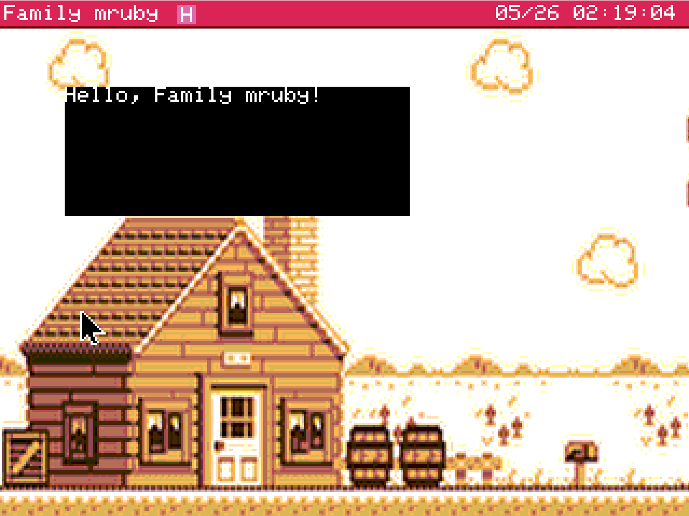
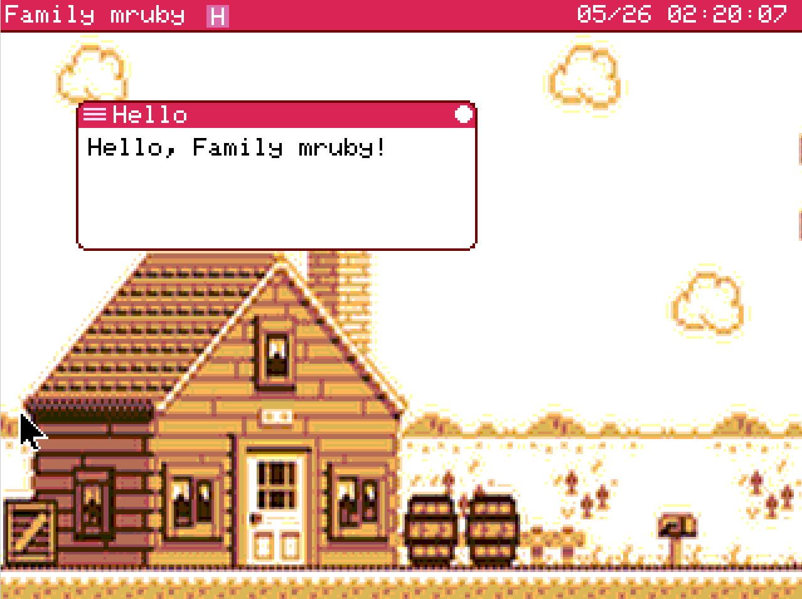

# Hello World

「Hello, mruby!」と画面に表示する最小の GUI アプリ を動かして、自分のアプリを書く流れを掴みます。

!!! note "このページは GUI アプリのサンプルです"
    Family mruby のアプリは大きく分けて、画面に描画する GUI アプリ と、画面を持たない headless アプリ（バックグラウンドで動く処理）があります。このページでは GUI アプリの最小例を扱います。
    headless アプリは `.app.toml` に `default_window_mode = "background"` と書きます。`@gfx` は `nil` です。

## 最小のアプリ構成

Family mruby のアプリは 2 つのファイル をペアで作ります。

```
hello.app.rb       # アプリ本体（Ruby）
hello.app.toml     # 設定ファイル
```

両方を `/app/<好きなディレクトリ>/` 以下に置き、ランチャーで再スキャン（[後述](#ランチャーに反映する)）または再起動するとアイコンが表示されます。

## Step 1: 文字を表示するだけの最小アプリ

画面上に"Hello, Family mruby!"と描画するだけのアプリを書いてみます。

!!! warning "このサンプルではウィンドウを閉じられません"
    `@gfx.clear` は キャンバス全体（タイトルバーを含む）を塗りつぶします。`FmrbApp` の基底クラスが起動時に描いてくれるタイトルバーと閉じるボタンが上書きされて消えてしまうため、画面上に閉じるボタンが見えなくなります。終了するには、一度リセットしてください。
    次のサンプルではWindowの枠の描画も行います。

`/app/usr/hello.app.rb` を作成して以下のようなコードを実装します。

コードはデフォルトアプリのエディターで実装してもよいですし、Webコンソールを利用してもよいです。コンソールの詳細は [コンソール](console.md) を参照。

### `/app/usr/hello.app.rb` ファイル

```ruby
class HelloApp < FmrbApp
  def on_create
    @gfx.clear(FmrbGfx::BLACK)
    @gfx.draw_text(0, 0, "Hello, Family mruby!", FmrbGfx::WHITE)
    @gfx.present
  end
end
```

コードの説明

| コード | 役割 |
|---|---|
| `class HelloApp < FmrbApp` | `FmrbApp` を継承するアプリクラス |
| `on_create` | 起動時に 1 回呼ばれる初期化処理 |
| `@gfx.clear(...)` | キャンバス全体を黒で塗りつぶし |
| `@gfx.draw_text(0, 0, ...)` | アプリの描画領域の左上 (0, 0)、つまりウィンドウ枠のすぐ内側に文字を描画 |
| `@gfx.present` | バッファを画面に反映（必須） |

末尾に `HelloApp.new.start` は書きません。ファイルを読み終えると、ランタイムがそのファイルで
定義された `FmrbApp` の子クラスを作って起動します。うまくいかないとき (子クラスが無い、起動中に
例外が出た) は、理由がエラーウィンドウに出ます。

### `hello.app.toml` ファイル

同じディレクトリに `hello.app.toml` を作成:

```toml
app_handle_name = "hello"
app_screen_name = "Hello"
default_window_mode = "window"
default_window_width = 160
default_window_height = 60
default_window_pos_x = 30
default_window_pos_y = 40
```

| キー | 用途 |
|---|---|
| `app_handle_name` | 内部ハンドル名（`.rb` ファイル名のベースと一致させる） |
| `app_screen_name` | ランチャーやタイトルバーの表示名 |
| `default_window_mode` | `"window"` / `"fullscreen"` |
| `default_window_width/height` | ウィンドウサイズ (px) |
| `default_window_pos_x/y` | ウィンドウ左上座標 |

同じキーは `.rb` 先頭の `#---fmrb` コメントにも書けるので、1 ファイルだけのアプリなら `.app.toml` は無くてもかまいません。全キーの説明は [アプリ設定ファイル (.app.toml)](../file_formats/app_toml.md) を参照。

### 起動して画面に表示する

1. 実装が完了したら、ランチャーを開いて 右クリック で再スキャン（または基板を再起動）
2. タイトルバーが「Rescanning...」になり、1〜2 秒待つと新アプリ「Hello」のアイコンが追加される
3. アイコンをダブルクリック（またはマウスでクリック → Enter）
4. 画面に「Hello, Family mruby!」と表示されます



## Step 2: ウィンドウ枠を表示する

Step1では、文字を表示しただけです。タイトルバーと閉じるボタンを残すには、キャンバス全体ではなく
アプリの描画可能領域 (user area) だけを塗りつぶします。それをするのが `clear_user_area` で、
ついでに枠も描き直します。

以下のように、更新してください。

```ruby
class HelloApp < FmrbApp
  def on_create
    redraw
  end

  def redraw
    clear_user_area                    # user area をテーマの紙の色で塗りつぶし
    @gfx.draw_text(4, 4, "Hello, Family mruby!", theme_fg)
    @gfx.present                       # 画面表示に反映
  end
end
```

| ポイント | 説明 |
|---|---|
| `@gfx.clear(FmrbGfx::BLACK)` → `clear_user_area` | 枠の内側をクリアし、枠を描き直す。色を省くとシステムのテーマの紙の色 |
| 決め打ちの色の代わりに `theme_fg` | テーマに合う文字の色。利用者の配色に従う |
| 描画ロジックを `redraw` に分離 | 後で再描画しやすくするための整理 |

!!! tip "(0, 0) はどこ?"
    `@gfx` とマウスのイベントは、アプリが描いてよい描画領域の左上から測ります。ここでは枠の内側、
    全画面なら画面の左上です。大きさは `@user_area_width` × `@user_area_height`。詳細は [FmrbApp ▸ アプリから読めるもの](../api/fmrb_app.md#アプリから読めるもの) を参照。

再起動してアプリを実行すると、タイトルバーやウィンドウ枠が描画されて、右上のボタンをクリックしてアプリを終了できるはずです。



## 起動中アプリを修正してリロードしたい場合

コードを書き換えて、起動中のアプリのタイトルバーを 右クリック し、ウィンドウのメニューから「読み直し」を選びます。
アプリを閉じて開きなおす手間が省けます。

## ショートカット: `create_app` でひな型を生成する

毎回 `.rb` と `.toml` を手書きするのは面倒です。Family mruby のシェルには `create_app` コマンドがあり、Step 2 ベースのひな型一式を一発で生成できます。

### 使い方

ランチャーから Shell を起動して、以下を実行:

```
> create_app my_clock
Created: /app/usr/my_clock.app.rb
Created: /app/usr/my_clock.app.toml
Tip: edit it with `edit /app/usr/my_clock.app.rb`
```

これで以下のファイルが自動作成されて、ひな形として利用できます。

- `/app/usr/my_clock.app.rb` — Step 2 ベース（`clear_user_area` 入り、全 `on_*` ライフサイクルメソッドのひな型あり）
- `/app/usr/my_clock.app.toml` — 標準サイズのウィンドウ設定

### ランチャーに反映する

ランチャーは起動時にアプリ一覧をスキャンして固定するため、ファイルを追加しても自動では出てきません。再スキャンを促すにはランチャーウィンドウ内で右クリックをおこなってください。再起動でも更新されます。

### アプリ用ファイルの命名規則

`create_app` コマンドの引数は 小文字英数字とアンダースコア のみ、先頭は英字。例:

| 入力 | 生成されるクラス名 | 表示名 |
|---|---|---|
| `hello` | `HelloApp` | `Hello` |
| `my_clock` | `MyClockApp` | `My Clock` |
| `snake01` | `Snake01App` | `Snake01` |

snake_case → CamelCase + `App` でクラス名、Title Case で表示名 (`app_screen_name`) が自動生成されます。

### 配置先

ひな型は `/app/usr/`（自動作成）に置かれます。

### テンプレートのカスタマイズ

ひな型ファイル本体は `/usr/share/template/` に置いてあります:

```
/usr/share/template/app.rb.template
/usr/share/template/app.toml.template
```

このファイルを直接編集すると、以後の `create_app` の出力を自分好みにカスタマイズできます。

| プレースホルダ | 意味 |
|---|---|
| `{{name}}` | snake_case の名前 |
| `{{class}}` | CamelCase のクラス名（末尾に `App`） |
| `{{title}}` | Title Case の表示名 |

## 次のステップ

- 図形を描いてみる → [FmrbGfx](../api/fmrb_gfx.md)
- イベント処理を加える → [FmrbApp ▸ イベントハンドリング](../api/fmrb_app.md#イベントハンドリング-on_eventev)
- 既存サンプルを読む → [標準アプリ](default_apps.md)

## トラブル時のチェック

### ランチャーにアイコンが出ない

- ランチャーで 右クリック して再スキャンしたか（→ [ランチャーで反映する](#ランチャーに反映する)）
- `.toml` ファイルが `.rb` と同じディレクトリにあるか
- `app_screen_name` が `.toml` に書かれているか
- `launcher_visible = false` を指定していないか
- ファイルの配置先が `/app/<dir>/` 以下になっているか

### 起動するがすぐ閉じる

- 例外で落ちている可能性。ログを確認:
    - `Log.info` を `on_create` に追加して進行を確認

### 画面に何も出ない

- `@gfx.present` を呼んでいるか確認
- 描画座標が `0..@user_area_width`、`0..@user_area_height` の範囲内か確認

### アプリを起動できないとエラーウィンドウが出る

- ファイルに `FmrbApp` の子クラスがあるか確認。2 つ以上あるときは `.app.toml` の `class = "..."` で起動するものを名指しする
- エラーウィンドウはクリックか、`Return`・`Esc` で閉じます。出ている間はキーボードを預かるので、キーが後ろのアプリに届くことはありません **(開発版)**

