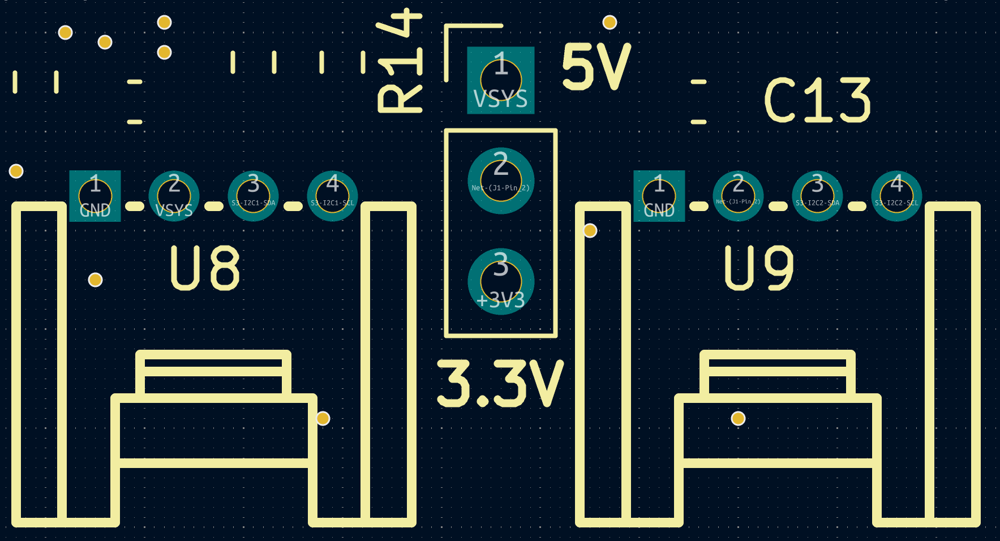
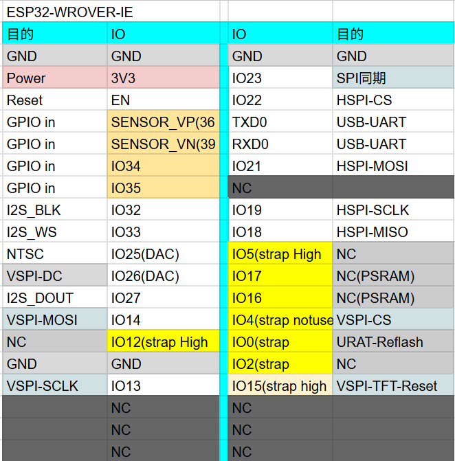
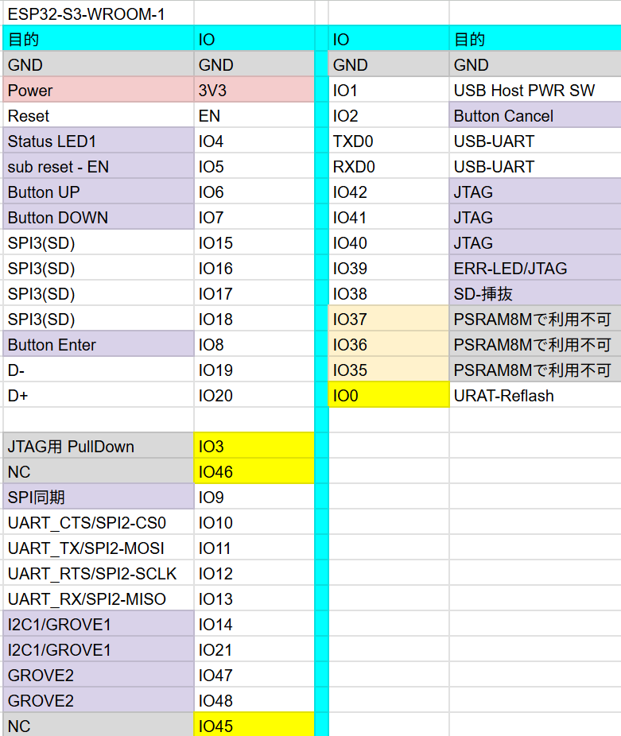
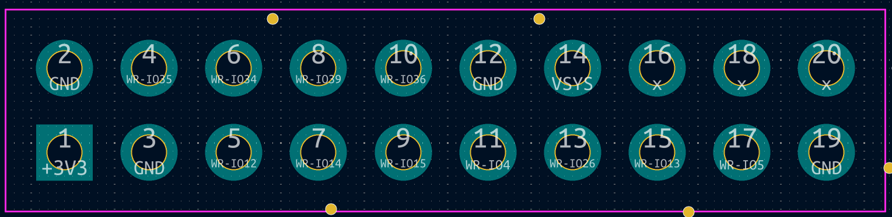

# ハードウェア

両機種の端子とピン配置と、そのほかのボードの紹介です。どちらにするか迷っている場合は
[機種の選択](getting_started/choose_hardware.md) から読んでください。

## Modern (M5Stack Tab5)

Modern は市販の [M5Stack Tab5](https://docs.m5stack.com/ja/core/Tab5) で動きます。以下は
Tab5 自体のハードウェアで、Family mruby はそのうち何を使い、何を予約するかを決めている
だけです。基板全体の仕様、端子の位置、外形図は M5Stack の資料を参照してください。

### 概要 (Modern)

| 項目 | 内容 |
|---|---|
| 主 MCU | ESP32-P4 (デュアルコア RISC-V)。OS・描画・音・入力をこの 1 個で処理 |
| 無線 | ESP32-C6 を副チップとして搭載。WiFi と BLE を同時に使えます |
| メモリ | PSRAM 32MB、フラッシュ 16MB |
| 表示 | 本体内蔵 IPS 液晶、1280 x 720、MIPI-DSI、静電容量式タッチつき |
| 表示バッファ | 426 x 240 の RGB332。P4 の PPA で 3 倍に拡大して液晶へ。`fullscreen_hires = true` のアプリが全画面の間は 640 x 360 (2 倍) |
| 音声 | 内蔵スピーカーとヘッドホン端子。ヘッドホンを挿すとスピーカーは消音されます |
| USB | USB-A ホスト端子 (キーボード・マウス・ハブ) と、電源・書き込み用の USB-C |
| 拡張 | GROVE x1 |
| 時計 | 内部 I2C 上の RX8130 |

### 映像 (Modern)

映像端子はありません。液晶そのものが出力先です。システムは 426 x 240 の RGB332 バッファに
描き、P4 の PPA が拡大と回転をして 1280 x 720 の液晶に載せます。CPU が全画素に触ることなく
画面いっぱいに表示されます。

Retro の NTSC 出力と違って画面の端が隠れないので、この機種では余白の設定
(`display_margin_x` / `display_margin_y`) は 0 になっています。

### 音声 (Modern)

Retro と同じファミコン風の APU ですが、P4 自身で合成して内蔵のコーデックから鳴らします。
ヘッドホンを挿すとスピーカーは消音されます。挿さっているかの判定は表示用の I2C 経由です。

[FmrbAudio](api/audio.md) と [音声ファイルフォーマット](file_formats/audio_formats.md) を
参照してください。

### GROVE (Modern)

GROVE 端子が 1 つ、GPIO53 (SDA 側) と GPIO54 (SCL 側) に出ています。

この端子は Retro の GROVE 2 と同じ考え方で二役あり、I2C バスとしても、シリアルの
[MIDI](api/midi.md) 出力としても使えます。どちらになるかは先に開いたほうで決まり、
ピン管理側が調停します。

| 信号 | GPIO | 他の用途 |
|---|---|---|
| Sig1 / SDA | 53 | MIDI の送信 |
| Sig2 / SCL | 54 | LED マトリクスのデモでは WS2812B のデータ線 |

### システムが確保しているピン (Modern)

以下はアプリからは取得できません。

| GPIO | 用途 |
|---|---|
| 0 / 1 | Tab5 Keyboard の I2C (STM32F030、アドレス 0x6D) |
| 50 | Tab5 Keyboard の割り込み |
| 31 / 32 | 本体タッチの I2C。汎用の I2C1 バスも兼ねます |
| 23 | タッチの割り込み |
| 22 | 液晶バックライト |
| 24 / 25 | USB-Serial-JTAG。USB-C の書き込み・コンソール用 |

USB-A ホスト端子は高速 OTG PHY 専用の端子に出ていて GPIO を経由しないので、GPIO を
消費しません。

### ストレージ (Modern)

内蔵フラッシュ (16MB) と microSD 差込口です。差込口は P4 の SDMMC ホスト
(4 ビット、GPIO 39〜44) につながり、`/mnt/sd` (`/sd` でも可) に長いファイル名の FAT として
見えます。カード検出の線が無いので、カードは入っているものとして扱います。

16MB のフラッシュには、ファームウェアと LittleFS のファイルシステム (`/app`、`/home`、`/usr`、
`/etc` など) が入っています。開発版では、日本語フォント (efont の 12 px・12 px 太字・16 px、約 1.3MB) を
ファームウェアから外してフラッシュの最後の専用のパーティションに置き、ファイルシステムは 8MB から
約 6.7MB になりました。フォントはフラッシュから直接読むので RAM を使いません。小さな 8 px の
フォントはファームウェアに残っていて、フォントのパーティションが無いときは全部の大きさをこれで
描きます。[インストーラ](getting_started/firmware_update.md) はこれらをまとめて書き込みます。

## Retro (narya-board)

narya-board の各端子・ピン配置の仕様です。

!!! note
    回路図・KiCAD 設計データ・基板写真は [narya-board リポジトリ](https://github.com/family-mruby/narya-board) を参照してください。

### 概要

| 項目 | 内容 |
|---|---|
| メイン MCU (fmrb-core) | ESP32-S3-WROOM-1-N16R8（16MB Flash + 8MB PSRAM） |
| サブ MCU (fmrb-graphics-audio) | ESP32-WROVER-E/IE（PSRAM 搭載） |
| MCU 間通信 | UART1（921600 bps、CTS/RTS フロー制御） |
| 映像出力 | NTSC コンポジット (LovyanGFX CVBS を利用) |
| 音声出力 | I2S DAC（NES APU エミュレータ） |
| ストレージ | 内蔵 LittleFS (16MB) + SD カード (FAT32, SPI 接続) |


### 電源

| 項目 | 値 |
|---|---|
| 入力 | USB Type-C (5V) |
| 内部レギュレータ | 3.3V |
| 推奨電源 | 1A以上の安定した USB 給電 |

### 映像出力

| 項目 | 値 |
|---|---|
| コネクタ | RCA（ピンジャック、黄色） |
| 信号方式 | NTSC コンポジット |
| 標準解像度 | 320 x 240 |
| カラー | RGB332（256 色） |

CRT モニタ／キャプチャデバイスの個体差で色味が変わる場合は、`FmrbGfx#set_output_level` / `set_chroma_level` で調整できます。

### 音声出力

| 項目 | 値 |
|---|---|
| コネクタ | 3.5mm ステレオミニジャック |
| 信号 | I2S → DAC でアナログ出力 |
| 出力レベル | ライン出力相当 |

NES APU エミュレータが動いており、矩形波 2 系統 + 三角波 + ノイズ の ４ チャンネルで音を鳴らせます。詳細は [FmrbAudio](api/audio.md) と [音声ファイルフォーマット](file_formats/audio_formats.md) を参照。

### GROVE

基板には 2 つの GROVE コネクタがあります。
左画からGND、電源、Sig1、Sig2 とした場合の接続品は以下の通りです。

| コネクタ | Sig2 | Sig2 | 備考 |
|---|---|---|---|
| GROVE 1 | GPIO 14/I2C1-SDA | GPIO 21/I2C1-SCL | I2C用/RTC (RX8900 アドレス:0x32) と共有。10Kプルアップ有り |
| GROVE 2 | GPIO 47 | GPIO 48 | 汎用。プルアップなし。電源選択可能 |

GROVE 1 は RTC が接続されている I2C バスを共有するため、アドレスの衝突に注意してください。

GROVE 2 は信号にプルアップなしで、電源の供給方法をピンヘッダで変更可能なので、GPIO、UARTや[RMT](api/peripherals.md#rmt) など自由な用途で利用可能です。



### PIN配置

#### ESP32-S3 PIN配置


GPIO40は、プルアップされた状態でRX8900のINTピンに接続している。

JTAGの機能は未検証だが、もし使いたい場合は0Ω抵抗を外す必要がある。詳細は回路図参照。

#### ESP32-WROVER PIN配置



### I2C

| バス | SDA | SCL | 備考 |
|---|---|---|---|
| I2C1 | GPIO 14 | GPIO 21 | RTC (RX8900) が共有 |
| I2C2 | GPIO 47 | GPIO 48 | 自由用途 |

`I2C.new(unit: "ESP32_I2C0", ...)` 等で利用します（[ハードウェア制御 ▸ I2C](api/peripherals.md#i2c) 参照）。

### 外出しGPIO

ピン位置 (S3)



ピン位置 (WROVER)



### RTC (リアルタイムクロック)

基板に RX8900 RTC IC（I2C アドレス 0x32、I2C1 経由）が搭載されています。電池で時刻保持されます。

```ruby
i2c = I2C.new(unit: "ESP32_I2C0")
rtc = RX8900.new(i2c)
rtc.sync_system_clock
```

詳細は [RX8900 API](api/peripherals.md#時計-rx8900--rx8130) を参照。

## ヘッドレス機 (M5Stack StickS3・AtomS3R)

ESP32-S3 を載せた市販の小型ボードで、同じ
[インストーラ](https://family-mruby.github.io/family-mruby-installer/) から書き込みます。
デスクトップは無く、それぞれ自分の小さな画面で 1 つのアプリを動かし、WiFi で
[Asterism](api/network.md#asterism-端末をまたぐオブジェクトとトピック) のネットワークに加わります。

| | StickS3 | AtomS3R |
|---|---|---|
| チップ | ESP32-S3 | ESP32-S3 (フラッシュ 8MB、PSRAM 8MB) |
| 画面 | 240 x 135 | 128 x 128 |
| ファームウェア | `fmruby-core-sticks3` | `fmruby-core-atoms3r` |

起動するアプリは Welcome で、版、WiFi の状態、アドレス、次にすることを表示します。
WiFi は [Family mruby コンソール](tools/console.md) から BLE で設定します。
ボタンを押したまま電源を入れるとセットアップモードになります (WiFi の設定が何も無い
ボードは自動でセットアップモードで起動します)。その後は、ほかのボードと同じファイルと
アプリのエンドポイントを使って、WiFi でアプリを送って起動します。制約は
[制約事項](limitations.md#画面の小さいヘッドレス機-m5stack-sticks3atoms3r) にあります。

## NARYA v4 (開発中)

ESP32-P4 モジュールと HDMI 出力を載せた自作のボードで、Modern が動きます。開発用で販売は
しておらず、インストーラにもファームウェアはありません。`FmrbConst::BOARD` は
`"naryav4"` になります。このページで Modern と言うときは Tab5 のことです。

## 関連

- ピンを使う前の確認 → [FmrbHw](api/const.md#fmrbhw)
- 周辺機器 API → [ハードウェア制御](api/peripherals.md)
- 起動から最初のアプリまで → [起動と接続](getting_started/setup.md)
