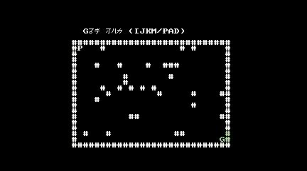

# FMRuby BASIC

ファミコン向けに出ていた Family BASIC との互換を目指して作った BASIC の処理系です。
画面もスプライトも音の命令も、そこに合わせてあります。

Ruby に BASIC 風の書き方を被せたものではありません。C++ で書いた独立した処理系で、
Family BASIC の意味論、28 x 24 文字の画面、`PLAY` / `BEEP` による音を持ちます。

## BASIC のプログラムを動かす

### エディタで書いて F5

一番早い方法です。Editor を開き、プログラムを書いて `F5` を押します。

- 名前がまだ無ければ保存先を聞かれます。`/home` か `/app` の下に保存してください
  (それ以外の場所のものは実行できません)
- 動いているプログラムからエディタへ戻るのは `Ctrl` + `Q` です。全画面のものからも
  これで抜けられます。戻ればそのまま `F5` で動かし直せます

### ランチャーに並べる

`.bas` と同じ名前の `.toml` を隣に置きます。

```
/app/basic/mygame.app.bas
/app/basic/mygame.app.toml
```

```toml
app_handle_name = "mygame"
app_screen_name = "My Game"
app_screen_name_ja = "マイゲーム"
# .bas は既定で全画面。ウィンドウにしたいときだけ書きます:
#default_window_mode = "window"
```

ランチャーの一覧はデスクトップの起動時に作られるので、後から置いたものを出すには
ランチャーの中で右クリックして読み直させます。

`.toml` が無いファイルも `F5` やシェルからは実行できます。その場合はファイル名が
アプリ名になります。

## 画面

Family BASIC の画面は 28 文字 x 24 行 (224 x 192 ドット) で固定です。全画面で起動した
ときは画面の中央に置かれ、周りは黒で塗られます。元と同じ形です。

<div align="center">
  
  <br><em><code>/app/basic</code> の <code>maze</code>。全部が文字で描かれています</em>
</div>

## 入っているもの

言語の中核、テキスト画面、自動で動くスプライト、コントローラ入力、`PLAY` と `BEEP`、
文字テーブルとパレットの選択、エラー処理、`SAVE` まで実装されています。`/app/basic` には
見本のプログラムが 3 つ (シューティング、迷路、音楽) と、BASIC のプログラムを普通の
アプリとして起動する BASIC デモが入っています。

## 互換性について

Family BASIC (V3) との違いは全件を洗い出して、解決済み・実装差として確定・データ待ち・
対象外に分類してあります。知っておくとよい「意図的な違い」を挙げます。

- `IF 式 THEN 文` は、条件が成立しないとき後続の `:` 文も飛ばします (Microsoft 系の挙動)
- `PLAY` は非同期です。音を鳴らしながらプログラムが進みます
- `LOAD` / `LOAD?` はプログラムの中では何もしません (元は直接モードの命令のため)。
  `SAVE` は実装しています
- `Ctrl` + `Q` で実行中のプログラムを止められます。元には全画面から抜ける手段が
  ありませんでした

## この MML は MIDI の MML とは別物です

BASIC の `PLAY` は Family BASIC の MML の書き方です。[MIDI](../api/midi.md) の層には
Ruby アプリ用の別の MML があります。実装も書き方も別なので、片方の文字列をもう片方に
写しても鳴りません。
