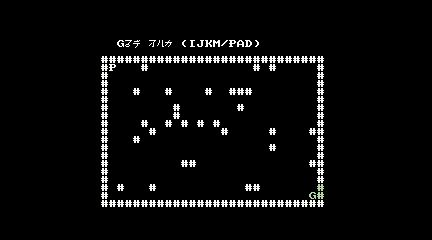

# FMRuby BASIC

A BASIC interpreter built to be compatible with Family BASIC — the BASIC that shipped
for the Famicom — down to its screen, its sprites and its sound statements.

This is not Ruby with a BASIC syntax on top: it is a separate interpreter written in C++,
with Family BASIC's semantics, its 28 x 24 character screen, and its `PLAY` / `BEEP` sound.

## Running a BASIC program

### Write it in the editor and press F5

The quickest route. Open the Editor, type the program, press `F5`.

- If the file has no name yet you will be asked for one. Save it under `/home` or
  `/app` — programs elsewhere will not run
- `Ctrl` + `Q` returns you to the editor from a running program, even a fullscreen one.
  Then `F5` runs it again

### Put it in the launcher

Drop a `.toml` next to the `.bas` with the same name:

```
/app/basic/mygame.app.bas
/app/basic/mygame.app.toml
```

```toml
app_handle_name = "mygame"
app_screen_name = "My Game"
app_screen_name_ja = "マイゲーム"
# .bas starts fullscreen unless you ask for a window:
#default_window_mode = "window"
```

The launcher builds its list when the desktop starts, so right-click inside the launcher
to rescan after adding a file.

A `.bas` without a `.toml` still runs from `F5` or from the shell; it just uses the filename
as its name.

## The screen

Family BASIC's screen is fixed at 28 characters by 24 lines (224 x 192 pixels). Started
fullscreen, it is centred and the surrounding area is filled with black — the same shape the
original had.

<div align="center">
  
  <br><em>The <code>maze</code> sample from <code>/app/basic</code>, drawn entirely out of characters</em>
</div>

## What is in it

The language core, the text screen, sprites with automatic movement, controller input,
`PLAY` and `BEEP`, character tables and palette selection, error handling and `SAVE` are all
implemented. Three sample programs ship in `/app/basic` — shoot, maze and music — beside the BASIC app
demo, which is a BASIC program launched as an ordinary app.

## Compatibility

Every known difference from Family BASIC V3 is written down and classified — resolved,
deliberate difference, waiting on measured data, or out of scope. Some deliberate choices
worth knowing:

- `IF expr THEN stmt` skips the `:` statements after it when the condition is false (the
  Microsoft-family behaviour)
- `PLAY` is asynchronous, so music continues while the program runs
- `LOAD` / `LOAD?` do nothing inside a program — on the original they were direct-mode
  commands. `SAVE` is implemented
- `Ctrl` + `Q` stops a running program. The original had no way out of a fullscreen program

## Its MML is not the MIDI MML

BASIC's `PLAY` uses Family BASIC's MML syntax. The [MIDI](../api/midi.md) layer has its own MML
for Ruby apps. They are separate implementations and the dialects differ — do not copy a
string from one to the other and expect it to play.
