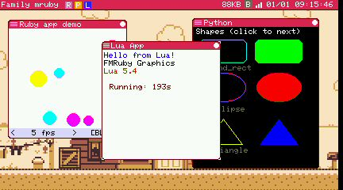

# 他の言語

Family mruby は Ruby を中心に作られていますが、動く言語は Ruby だけではありません。
4 つあります。Ruby、MicroPython、BASIC、Lua です。

切り替えて使う「モード」ではありません。`.py` も `.bas` も、Ruby のアプリと並んで
ランチャーに出て、同じように起動し、互いに同時に動きます。

  
   <em>VM が 3 つ同時に動いているところ。Ruby、Lua、MicroPython が、それぞれ別のウィンドウと別のヒープで動きます</em>

| 拡張子 | 実行系 | 備考 |
|---|---|---|
| `.rb` | PicoRuby | 中心となる言語。[API リファレンス](../api/index.md) の全部が使えます |
| `.py` | MicroPython | Ruby と同じアプリの枠組み。ウィンドウ・描画・スプライト・音。同時に 1 本だけ |
| `.bas` | FMRuby BASIC | Family BASIC 互換。専用のテキスト画面とスプライトを持ちます |
| `.lua` | Lua 5.4 | 関数 `on_create` / `on_update` / `on_event` とグローバルの `gfx`。ウィンドウとループは本体が持ちます |
| `.wasm` | WAMR | C・TinyGo・Rust・Zig で書き、パソコンで WebAssembly にコンパイルしたアプリ。ESP32-S3 の基板では動きません。[WebAssembly のアプリ](wasm.md) を参照 **(3.1.0 から)** |

アプリから呼べる関数は、ファームウェアの型定義の 1 か所で定義し、各言語の側はそこから生成しています。
そのため Ruby・Lua・MicroPython・WebAssembly の各言語で、名前も引数の順も同じです
(どれも `draw_text(x, y, text, color)`)。Ruby の Symbol、キーワード引数、`?` で終わるメソッドは、
それぞれの言語らしい書き方になります (BASIC は独自の命令のままです)。

## どれを使うか

- **Ruby**: API を一通り使いたいとき (ネットワーク、MIDI、スプライト、周辺機器)。
  システムはこの言語を中心に設計されています
- **MicroPython**: Python が手に馴染んでいるとき。ただし標準ライブラリは普段より
  かなり狭く、同時に動かせるのは 1 本だけです
- **BASIC**: Family BASIC の感触が欲しいとき。当時の雑誌の投稿作品を打ち込むとき
- **Lua**: 小さくて速いスクリプトを書きたいとき
- **C・TinyGo・Rust・Zig**: これらの言語で書いてパソコンでコンパイルしたいとき。
  [WebAssembly のアプリ](wasm.md) を参照してください。ESP32-S3 の基板では動きません

## 関連

- [MicroPython](micropython.md)・[Lua](lua.md)・[FMRuby BASIC](basic.md) — 言語ごとのページ
- [標準アプリ](../getting_started/default_apps.md) — 各言語の見本
- [WebAssembly のアプリ](wasm.md) — C・TinyGo・Rust・Zig
- [アプリ設定ファイル (.toml)](../file_formats/app_toml.md)
- [API リファレンス](../api/index.md) — 他の言語が写している Ruby の API
