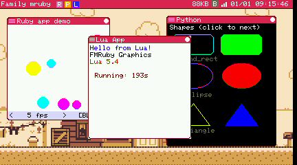

# Other Languages

Ruby is the language Family mruby is built around, but it is not the only one that runs on
it. There are four: Ruby, MicroPython, BASIC and Lua.

They are not modes you switch into. A `.py` file and a `.bas` file sit in the launcher next
to the Ruby apps, start the same way, and run at the same time as each other.

  
   <em>Three VMs at once — Ruby, Lua and MicroPython, each in its own window and its own heap</em>

| Extension | Runs on | Notes |
|---|---|---|
| `.rb` | PicoRuby | The main language. Everything in the [API Reference](../api/index.md) |
| `.py` | MicroPython | The same app framework as Ruby: windows, drawing, sprites, sound. One Python app at a time |
| `.bas` | FMRuby BASIC | Family BASIC compatible. Its own text screen and sprites |
| `.lua` | Lua 5.4 | Functions `on_create` / `on_update` / `on_event` and a global `gfx`; the system draws the window and runs the loop |
| `.wasm` | WAMR | Apps written in C, TinyGo, Rust or Zig and compiled to WebAssembly on a PC. Not on the ESP32-S3 boards. See [WebAssembly Apps](wasm.md) **(from 3.1.0)** |

The functions an app can call are defined once, in the firmware's type definitions, and each
language's side is generated from there. Ruby, Lua, MicroPython and the WebAssembly languages
therefore see the same names in the same argument order — `draw_text(x, y, text, color)`
everywhere — with each language's own spelling for what Ruby writes as a Symbol, a keyword
argument or a method ending in `?` (BASIC keeps its own statements).

## Which one to reach for

- **Ruby** for anything that needs the full API — networking, MIDI, sprites, the peripheral
  bus. This is the language the system is designed around
- **MicroPython** if Python is what you know. Expect a smaller standard library than you are
  used to, and one Python app at a time
- **BASIC** if you want the Family BASIC experience, or you are following a listing from a
  magazine of the era
- **Lua** for a small, fast script
- **C, TinyGo, Rust or Zig** if you would rather write in one of those and compile it on a
  PC — see [WebAssembly Apps](wasm.md). Not on the ESP32-S3 boards

## Related

- [MicroPython](micropython.md), [Lua](lua.md) and [FMRuby BASIC](basic.md) — a page for each
- [Default Apps](../getting_started/default_apps.md) — the samples in each language
- [WebAssembly Apps](wasm.md) — C, TinyGo, Rust and Zig
- [App Config (.app.toml)](../file_formats/app_toml.md)
- [API Reference](../api/index.md) — the Ruby API the other languages mirror
