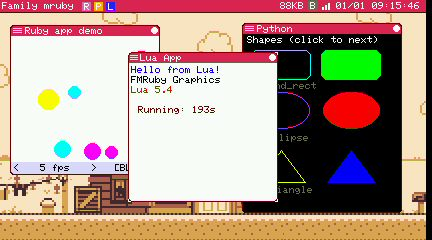
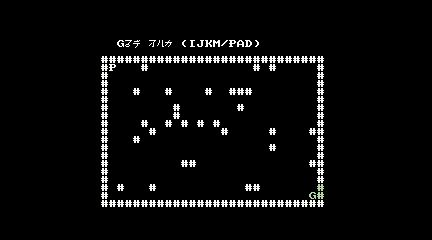

# MicroPython と BASIC

Family mruby は Ruby を中心に作られていますが、動く言語は Ruby だけではありません。
4 つあります。Ruby、MicroPython、BASIC、Lua です。

切り替えて使う「モード」ではありません。`.py` も `.bas` も、Ruby のアプリと並んで
ランチャーに出て、同じように起動し、互いに同時に動きます。

<div align="center">
  
  <br><em>VM が 3 つ同時に動いているところ。Ruby、Lua、MicroPython が、それぞれ別のウィンドウと別のヒープで動きます</em>
</div>

| 拡張子 | 実行系 | 備考 |
|---|---|---|
| `.rb` | PicoRuby | 中心となる言語。[API リファレンス](api/index.md) の全部が使えます |
| `.py` | MicroPython | Ruby と同じアプリの枠組み。ウィンドウ・描画・スプライト・音。同時に 1 本だけ |
| `.bas` | FMRuby BASIC | Family BASIC 互換。専用のテキスト画面とスプライトを持ちます |
| `.lua` | Lua 5.4 | 関数 `on_create` / `on_update` / `on_event` とグローバルの `gfx`。ウィンドウとループは本体が持ちます |
| `.wasm` | WAMR | C・TinyGo・Rust・Zig で書き、パソコンで WebAssembly にコンパイルしたアプリ。ESP32-S3 の基板では動きません。[WebAssembly のアプリ](wasm_apps.md) を参照 **(開発版)** |

アプリから呼べる関数は、ファームウェアの型定義の 1 か所で定義し、各言語の側はそこから生成しています。
そのため Ruby・Lua・MicroPython・WebAssembly の各言語で、名前も引数の順も同じです
(どれも `draw_text(x, y, text, color)`)。Ruby の Symbol、キーワード引数、`?` で終わるメソッドは、
それぞれの言語らしい書き方になります (BASIC は独自の命令のままです)。

---

# MicroPython

`.py` のファイルも、他と同じアプリです。Ruby と同じ枠組みを使います。`FmrbApp` を継承し、
決められたメソッドを書き、起動します。Ruby と違い、Python のファイルは今も最後に
アプリを起動する行が要ります。

```python
class PythonDemoApp(FmrbApp):
    def on_create(self):
        Log.info("started on " + self.platform)
        self.clear_user_area()   # Ruby と同じく、(0, 0) は枠の内側の左上
        self.gfx.present()

    def on_update(self):
        return 500          # 次に呼ばれるまでのミリ秒

    def on_event(self, ev):
        if ev.get("type") == "mouse_up" and ev.get("button") == 1:
            self.next_page()

PythonDemoApp().start()
```

ウィンドウ・イベント・描画は組み込みの `_fmrb` から使えます。継承する `FmrbApp` がそれを
包んでいます。`FmrbApp` / `FmrbGfx` / `FmrbAudio` / `FmrbFile` / `SpriteImage` /
`SpriteInstance` / `Log` はアプリの名前空間に用意済みで、import は要りません。

見本は `/app/python/python.app.py` (PicoRuby デモの双子。ページを順に見せます) と
`/app/game/breakout/breakout.app.py` です。後者はゲーム 1 本まるごとで、動くものは
スプライト、動かないものはタイル、日本語の文字、主音源の曲と副音源の効果音が入って
います。ロボットエクスプローラーには Python 版の操縦もあります。

## Ruby との違い

| | Ruby | Python |
|---|---|---|
| 時刻 | `Machine.board_millis` | `ticks_ms()` か `FmrbApp.uptime_ms()` |
| 問いのメソッド | `FmrbFile.exist?(path)` | `FmrbFile.exist(path)` (`?` を落とします) |
| 文字列の長さ | `String#length` は文字数 | `len()` は**バイト数** |
| 別ファイル | `require "/app/..."` | `import mymodule` (アプリの隣か `/usr/lib/python`) |
| 別ファイルからの枠組み | 見えます | **見えません**。引数で渡します |
| タイマの callback | ブロック | 関数 (`self.set_timer(500, self.blink)`) |

アプリを複数のファイルに分けられますが、枠組みのクラスはアプリの名前空間にあり、
module の名前空間には入りません。

```python
# アプリ側
import mypanel
mypanel.draw(self, state)

# mypanel.py 側
def draw(app, state):
    app.gfx.draw_text(...)   # FmrbGfx を直接名指しせず、app 経由で使う
```

1 ファイルの大きさは 64KB までです。

## 音

内蔵音源は `FmrbAudio` から使います。形は Ruby と同じです。曲は主系、短い効果音は副系に
置くと、効果音で曲が止まりません。

```python
audio = FmrbAudio(self)
audio.load_fmsq_file(1, "/cache/app/mygame/bgm.fmsq")   # 先に sync_file で送る
audio.play_slot(1, FmrbAudio.MAIN)
audio.note_on(FmrbAudio.CH_PULSE2, 988, 12, 2, 0)       # 効果音は副系
```

効果音を止める時刻はフレーム数ではなく `ticks_ms()` の実時間で管理してください。重い
フレームがあると音が伸びます。

Ruby の `FmrbAudio` のほかのメソッドもあります。`stop`、`pause`、`resume`、`nsf_status()`
(dict か `None`)、`set_main_volume(percent)` (Ruby の `main_volume =`)、`play_wav(path)`、
`stop_wav()`、`load_fmsq(slot, data)` です。`Log.info` などは、Ruby と同じく行の頭にアプリの
名前を付けます。

## 描画

`FmrbGfx` には Ruby の描画のメソッドが全部あり、名前も引数の順も同じです。円弧・楕円・三角形を
含む図形、`get_pixel`、`blend_rect`、画像とマスク、表示範囲とスプライトの切り抜き、
`file_status`、`FmrbGfx.rgb_to_332` などです。省略できる引数を持つもの (`present`、`draw_text`、
`set_font`、`draw_image`、`draw_tile`、`sync_file` など) は、Python の既定値で受けます。

```python
self.gfx.set_font(FmrbGfx.FONT_JA, 12)
self.gfx.draw_text(4, 4, "こんにちは", FmrbGfx.BLACK)
self.gfx.draw_text(4, 20, "mixed 日本語", FmrbGfx.BLACK, mixed=True)
```

`clear` には既定値がないので、色を渡してください (`self.gfx.clear(FmrbGfx.BLACK)`)。
`canvas_id`・`origin_x`・`origin_y`・`area_width`・`area_height` は読み取り専用のプロパティです。

## 制限

MicroPython 自体の作りによる制限がいくつかあります。始める前に知っておいてください。

Python アプリは同時に 1 本だけです。MicroPython は VM の状態を全部グローバル変数に持って
いるので、mruby や Lua と違って 2 つ作れません。2 本目は起動の時点で断られ、「Another
Python app is already running.」と出ます。Ruby / Lua / BASIC のアプリとの同時実行には
制限はありません。

import できるのは組み込みのモジュールと、アプリの隣か `/usr/lib/python` にある `.py` です。
使えるものは `array` / `builtins` / `collections` / `gc` / `io` / `math` / `micropython` /
`struct` / `sys` / `random`。使えないものは `time` / `json` / `os` / `re` / `binascii` /
`hashlib` / `heapq` / `deflate` です。これらは MicroPython の `extmod/` にあり、この構成には
含まれていません。待つときは、眠るのではなく `on_update` の戻り値で間隔を指定してください。
(`random` は時計から種を取っているので毎回違う目が出ます。同じ展開を繰り返すなら
`random.seed(n)` を呼んでください。)

ファイルは、Ruby のアプリと同じモジュール `FmrbFile` で丸ごと読み書きします。
`FmrbFile.read(path)` はファイル全体を `bytes` で返し (無ければ `None`)、`write`・`append`・
`exist`・`size`・`delete`・`mkdir`・`list(dir)` もパスを取ります
([ファイル・I/O](api/filesystem.md#パスで丸ごと読み書きする-fmrbfile) を参照)。少しずつ読む口は
ありません。`open()` はありますが、呼ぶと `OSError` になります。黙って存在しないより、
呼んで失敗するほうが分かるためです。`io.StringIO` などメモリ上のものは使えます。

整数は 64 ビットまで扱えるので、`FmrbApp.uptime_us()` は ESP32 で small int に収まる
約 18 分を過ぎても数え続けます。それより広い整数は `OverflowError` になります。

文字列はバイト列です。この構成には Unicode 文字列が入っていないので、`len("日本語")` は
9 で、添字もバイト単位です。表示幅が要るときは UTF-8 を走査する `FmrbGfx.text_width` を
使ってください。

REPL もスレッドもありません。タスクを作るのは OS の仕事で、ゲスト VM には渡していません。
アプリの中の並行処理はジェネレータで書けます。

GC のヒープは 1 アプリ 256KB 固定です。使い切ると `MemoryError` になり、捕まえなければ
traceback をログに出してアプリが終わります。Ruby のメモリ不足と同じ扱いです。

強制停止では `on_destroy` が走りません。Python の長いループの途中で止めると、バイトコードの
実行を巻き戻す形になるので、`destroy` も `on_destroy` も通りません。資源は C 側が回収するので
漏れませんが、後始末を `on_destroy` に頼らず、`on_update` の区切りで行ってください。Lua も
同じ性質です。

用意していないもの: タイルマップのクラス (`draw_tile` はあるので自分で並べます)、
`load_image` (`sync_file`・`create_image`・`draw_image` で書きます)、動画、`GfxBlock`、
追加のキャンバス、p5 互換層、マイク入力と外部への MIDI 送出。

---

# Lua

`.lua` のアプリは、本体が C で用意するアプリシェルの上で動きます。ウィンドウを作り、枠を描き、ループを回すのは
本体で、アプリは関数を定義するだけです。形は Ruby のアプリにそろえてあります。

```lua
local seconds = 0

function on_create()            -- ウィンドウができた後に 1 回
  FmrbApp.clear_user_area()     -- 描画領域をテーマの色で塗り、枠を描き直す
  gfx:draw_text(2, 2, "Hello", FmrbApp.THEME_TEXT)
  gfx:present()
end

function on_update()            -- 返した ms の後にまた呼ばれる (数でなければ 330)
  seconds = seconds + 1
  return 1000
end

function on_event(ev)           -- 入力 1 つごと
  if ev.type == "key_down" and ev.character == string.byte("q") then
    FmrbApp.stop()
  end
end
```

- ファイルのトップレベルは最初に 1 回だけ走ります (関数と変数を定義する所)。そこではまだ
  `gfx` はありません。`on_create`・`on_update`・`on_event` のどれも定義しないファイルは起動せず、
  エラーウィンドウが出ます。
- 任意の関数: `on_destroy`、`on_suspend` / `on_resume`、`on_resize(w, h)` (アプリシェルが描画領域を塗り直して
  枠を描いた後)、`on_quit_request` (Ctrl+Q。無ければ閉じる)。
- 関数の中でエラーになると、メッセージとトレースバックのエラーウィンドウが出てアプリは終わります。
  関数の中で長く待たず、待ちは `on_update` の返り値で表します。1 秒以上戻らない関数は、
  閉じるボタンと kill で打ち切られます。
- `gfx` は Ruby の `@gfx` と同じく、枠の内側の左上を (0, 0) として描きます。メソッドは Ruby の
  `FmrbGfx` と同じ名前・同じ引数の順です: `fill_rect(x, y, w, h, c)`・`draw_line`・
  `fill_circle`・`draw_ellipse`・`draw_arc` など、`draw_text(x, y, text, c [, bg [, mixed]])`・
  `set_font(family [, size])`・`present()`。Ruby の Symbol は文字列 (`gfx:set_font("ja", 12)`)、
  記録は表になります。`gfx:clear(c)` は枠ごとキャンバス全体を消し、
  `FmrbApp.clear_user_area([c])` は描画領域を消して枠を描き直します。
- 大きさは関数で、呼んだ時点の値を返します。描画領域は `FmrbApp.user_area_width()` /
  `user_area_height()`、ウィンドウは `FmrbApp.window_width()` / `window_height()`。
- 描画のほかにも、Ruby のアプリにあるものが使えます。`FmrbAudio.new()` と `audio:note_on(...)`・
  `audio:play_wav(path)` など、`Log.info(msg)`、`FmrbApp.clipboard()`・`FmrbApp.uptime_ms()`・
  `FmrbApp.wallclock()`、ウィンドウの状態と要求 (`FmrbApp.fullscreen()`・
  `FmrbApp.request_fullscreen(on)` など)、`FmrbFile` によるファイルの丸ごとの読み書き
  (`FmrbFile.read(path)`・`FmrbFile.exist(path)` など)。Ruby で `?` で終わるメソッドは、Lua では
  `?` を落とした名前です。
- `ev` のキーは Ruby と同じで、`ev.type` は文字列です: `"key_down"`・`"key_up"`・
  `"mouse_down"`・`"mouse_up"`・`"mouse_move"`・`"mouse_wheel"`・`"gamepad_down"`・
  `"gamepad_up"`・`"gamepad_axis"`・`"kana_mode"`。マウスのイベントは `x` / `y` (描画領域) と
  `wx` / `wy` (ウィンドウ) を持ちます。閉じるボタン、タイトルバーのウィンドウのメニュー、ドラッグは
  本体が受け持ちます。
- 色は `FmrbGfx.BLACK` などの定数と、テーマの `FmrbApp.THEME_WINDOW_BG`・`THEME_TEXT`・
  `THEME_BORDER` など。

見本は `/app/lua/lua.app.lua` です。

---

# FMRuby BASIC

ファミコン向けに出ていた Family BASIC との互換を目指して作った BASIC の処理系です。
画面もスプライトも音の命令も、そこに合わせてあります。

Ruby に BASIC 風の書き方を被せたものではありません。C++ で書いた独立した処理系で、
Family BASIC の意味論、28 x 24 文字の画面、`PLAY` / `BEEP` による音を持ちます。

## BASIC のプログラムを動かす

### エディタで書いて F5

一番早い方法です。Editor を開き、プログラムを書いて `F5` を押します。

- 名前がまだ無ければ保存先を聞かれます。`/home` か `/app` の下に保存してください
  (それ以外の場所のものは実行できません)
- 動いているプログラムからエディタへ戻るのは `Ctrl` + `Q` です。全画面のものからも
  これで抜けられます。戻ればそのまま `F5` で動かし直せます

### ランチャーに並べる

`.bas` と同じ名前の `.toml` を隣に置きます。

```
/app/basic/mygame.app.bas
/app/basic/mygame.app.toml
```

```toml
app_handle_name = "mygame"
app_screen_name = "My Game"
app_screen_name_ja = "マイゲーム"
# .bas は既定で全画面。ウィンドウにしたいときだけ書きます:
#default_window_mode = "window"
```

ランチャーの一覧はデスクトップの起動時に作られるので、後から置いたものを出すには
ランチャーの中で右クリックして読み直させます。

`.toml` が無いファイルも `F5` やシェルからは実行できます。その場合はファイル名が
アプリ名になります。

## 画面

Family BASIC の画面は 28 文字 x 24 行 (224 x 192 ドット) で固定です。全画面で起動した
ときは画面の中央に置かれ、周りは黒で塗られます。元と同じ形です。

<div align="center">
  
  <br><em><code>/app/basic</code> の <code>maze</code>。全部が文字で描かれています</em>
</div>

## 入っているもの

言語の中核、テキスト画面、自動で動くスプライト、コントローラ入力、`PLAY` と `BEEP`、
文字テーブルとパレットの選択、エラー処理、`SAVE` まで実装されています。`/app/basic` には
見本のプログラムが 3 つ (シューティング、迷路、音楽) と、BASIC のプログラムを普通の
アプリとして起動する BASIC デモが入っています。

## 互換性について

Family BASIC (V3) との違いは全件を洗い出して、解決済み・実装差として確定・データ待ち・
対象外に分類してあります。知っておくとよい「意図的な違い」を挙げます。

- `IF 式 THEN 文` は、条件が成立しないとき後続の `:` 文も飛ばします (Microsoft 系の挙動)
- `PLAY` は非同期です。音を鳴らしながらプログラムが進みます
- `LOAD` / `LOAD?` はプログラムの中では何もしません (元は直接モードの命令のため)。
  `SAVE` は実装しています
- `Ctrl` + `Q` で実行中のプログラムを止められます。元には全画面から抜ける手段が
  ありませんでした

## この MML は MIDI の MML とは別物です

BASIC の `PLAY` は Family BASIC の MML の書き方です。[MIDI](api/midi.md) の層には
Ruby アプリ用の別の MML があります。実装も書き方も別なので、片方の文字列をもう片方に
写しても鳴りません。

---

## どれを使うか

- **Ruby**: API を一通り使いたいとき (ネットワーク、MIDI、スプライト、周辺機器)。
  システムはこの言語を中心に設計されています
- **MicroPython**: Python が手に馴染んでいるとき。ただし標準ライブラリは普段より
  かなり狭く、同時に動かせるのは 1 本だけです
- **BASIC**: Family BASIC の感触が欲しいとき。当時の雑誌の投稿作品を打ち込むとき
- **Lua**: 小さくて速いスクリプトを書きたいとき
- **C・TinyGo・Rust・Zig**: これらの言語で書いてパソコンでコンパイルしたいとき。
  [WebAssembly のアプリ](wasm_apps.md) を参照してください。ESP32-S3 の基板では動きません

## 関連

- [標準アプリ](getting_started/default_apps.md) — 各言語の見本
- [WebAssembly のアプリ](wasm_apps.md) — C・TinyGo・Rust・Zig
- [アプリ設定ファイル (.toml)](file_formats/app_toml.md)
- [API リファレンス](api/index.md) — 他の言語が写している Ruby の API
