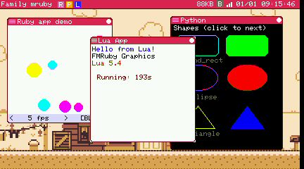
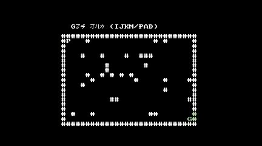

# MicroPython and BASIC

Ruby is the language Family mruby is built around, but it is not the only one that runs on
it. There are four: Ruby, MicroPython, BASIC and Lua.

They are not modes you switch into. A `.py` file and a `.bas` file sit in the launcher next
to the Ruby apps, start the same way, and run at the same time as each other.

<div align="center">
  
  <br><em>Three VMs at once — Ruby, Lua and MicroPython, each in its own window and its own heap</em>
</div>

| Extension | Runs on | Notes |
|---|---|---|
| `.rb` | PicoRuby | The main language. Everything in the [API Reference](api/index.md) |
| `.py` | MicroPython | The same app framework as Ruby: windows, drawing, sprites, sound. One Python app at a time |
| `.bas` | FMRuby BASIC | Family BASIC compatible. Its own text screen and sprites |
| `.lua` | Lua 5.4 | Functions `on_create` / `on_update` / `on_event` and a global `gfx`; the system draws the window and runs the loop |
| `.wasm` | WAMR | Apps written in C, TinyGo, Rust or Zig and compiled to WebAssembly on a PC. Not on the ESP32-S3 boards. See [WebAssembly Apps](wasm_apps.md) **(development version)** |

The functions an app can call are defined once, in the firmware's type definitions, and each
language's side is generated from there. Ruby, Lua, MicroPython and the WebAssembly languages
therefore see the same names in the same argument order — `draw_text(x, y, text, color)`
everywhere — with each language's own spelling for what Ruby writes as a Symbol, a keyword
argument or a method ending in `?` (BASIC keeps its own statements).

---

# MicroPython

A `.py` file is an app like any other. It uses the same framework Ruby apps use — subclass
`FmrbApp`, override the lifecycle methods, start it. Unlike a Ruby file, a Python file still
ends with the line that starts the app:

```python
class PythonDemoApp(FmrbApp):
    def on_create(self):
        Log.info("started on " + self.platform)
        self.clear_user_area()   # (0, 0) is the top-left inside the frame, as in Ruby
        self.gfx.present()

    def on_update(self):
        return 500          # ms until the next turn

    def on_event(self, ev):
        if ev.get("type") == "mouse_up" and ev.get("button") == 1:
            self.next_page()

PythonDemoApp().start()
```

Windows, events and drawing are reachable through the built-in `_fmrb` module, wrapped in
the framework classes an app subclasses. `FmrbApp`, `FmrbGfx`, `FmrbAudio`, `FmrbFile`,
`SpriteImage`, `SpriteInstance` and `Log` are already in the app's namespace — there is
nothing to import for them.

The demos are `/app/python/python.app.py` (the twin of the PicoRuby demo, page by page) and
`/app/game/breakout/breakout.app.py`, a whole game: sprites for the things that move, tiles
for the things that do not, Japanese text, a tune on the main sound chip with effects on
the other. Robo Explorer has a Python pilot as well.

## Where it differs from Ruby

| | Ruby | Python |
|---|---|---|
| Time | `Machine.board_millis` | `ticks_ms()`, or `FmrbApp.uptime_ms()` |
| A query method | `FmrbFile.exist?(path)` | `FmrbFile.exist(path)` — the `?` is dropped |
| String length | `String#length` counts characters | `len()` counts **bytes** |
| Another file | `require "/app/..."` | `import mymodule` — beside the app, or `/usr/lib/python` |
| The framework, from that file | Visible | **Not visible**. Pass what it needs as arguments |
| A timer's callback | A block | A function: `self.set_timer(500, self.blink)` |

Splitting an app across files works, but the framework classes live in the app's namespace
and not in the module's:

```python
# in the app
import mypanel
mypanel.draw(self, state)

# in mypanel.py
def draw(app, state):
    app.gfx.draw_text(...)   # reached through the app, not named directly
```

One file is limited to 64 KB.

## Sound

The sound chip is reached through `FmrbAudio`, the same shape as in Ruby. A tune goes on
the main instance and short effects on the other, so an effect does not stop the music:

```python
audio = FmrbAudio(self)
audio.load_fmsq_file(1, "/cache/app/mygame/bgm.fmsq")   # sync_file it across first
audio.play_slot(1, FmrbAudio.MAIN)
audio.note_on(FmrbAudio.CH_PULSE2, 988, 12, 2, 0)       # an effect, on the other
```

Time an effect's end by `ticks_ms()`, not by counting frames: a heavy frame stretches the
sound.

The rest of Ruby's `FmrbAudio` is there too: `stop`, `pause`, `resume`, `nsf_status()` (a
dict or `None`), `set_main_volume(percent)` (Ruby's `main_volume =`), `play_wav(path)`,
`stop_wav()` and `load_fmsq(slot, data)`. `Log.info` and its siblings put the app's name at
the head of the line, as they do in Ruby.

## Drawing

`FmrbGfx` has every drawing method Ruby's has, with the same names and argument order:
the shapes including arcs, ellipses and triangles, `get_pixel`, `blend_rect`, images and
masks, the viewport and sprite clipping, `file_status`, `FmrbGfx.rgb_to_332` and the rest.
The ones with optional arguments (`present`, `draw_text`, `set_font`, `draw_image`,
`draw_tile`, `sync_file`, ...) take them as Python defaults:

```python
self.gfx.set_font(FmrbGfx.FONT_JA, 12)
self.gfx.draw_text(4, 4, "こんにちは", FmrbGfx.BLACK)
self.gfx.draw_text(4, 20, "mixed 日本語", FmrbGfx.BLACK, mixed=True)
```

`clear` has no default: pass the colour (`self.gfx.clear(FmrbGfx.BLACK)`). `canvas_id`,
`origin_x`, `origin_y`, `area_width` and `area_height` are read-only properties.

## Limitations

MicroPython's design pushes back in a few places, and these are worth knowing before you
start:

One Python app at a time. MicroPython keeps its entire VM state in globals, so unlike mruby
and Lua it cannot be instantiated twice. Starting a second one is refused at spawn with
"Another Python app is already running." Ruby, Lua and BASIC apps are unaffected and can run
alongside it.

Built-in modules only. `array`, `builtins`, `collections`, `gc`, `io`, `math`,
`micropython`, `struct`, `sys` and `random` are in. `time`, `json`, `os`, `re`, `binascii`,
`hashlib`, `heapq` and `deflate` are not — they live in MicroPython's `extmod/`, which this
build does not carry. For waiting, return a delay from `on_update` rather than sleeping.
(`random` is seeded from the clock, so a run differs from the last; call `random.seed(n)`
to repeat one.)

Files are read and written whole, through `FmrbFile`, the same module Ruby apps have.
`FmrbFile.read(path)` returns the whole file as `bytes` (or `None`), and `write`, `append`,
`exist`, `size`, `delete`, `mkdir` and `list(dir)` take a path — see
[Files & I/O](api/filesystem.md#whole-files-by-path-fmrbfile). There is no reading a file a
piece at a time: `open()` exists but raises `OSError`, because failing out loud beats being
silently absent. `io.StringIO` and the rest of the in-memory objects work.

Integers go up to 64 bits, so `FmrbApp.uptime_us()` keeps counting past the 18 minutes a
small integer holds on the ESP32; anything wider raises `OverflowError`.

Strings are bytes. This build has no Unicode strings, so `len("日本語")` is 9 and indexing
is by byte. For a width in pixels use `FmrbGfx.text_width`, which walks the UTF-8.

No REPL and no threads. Creating tasks is the system's job, not a guest VM's; use a
generator for concurrency inside an app.

256 KB of heap per app, fixed. Running out raises `MemoryError`, and an uncaught one ends
the app with a traceback in the log, exactly as running out of memory does in Ruby.

A force-stop skips `on_destroy`. Stopping an app that is inside a long Python loop unwinds
the bytecode, so neither `destroy` nor `on_destroy` runs. Resources are reclaimed by the C
side either way, but an app cannot rely on `on_destroy` to save anything — do that at a
boundary in `on_update`. Lua behaves the same way.

Not provided: tile map classes (`draw_tile` is there — lay them out yourself), `load_image`
(write it as `sync_file`, `create_image` and `draw_image`), video, `GfxBlock`, extra
canvases, the p5 layer, the microphone and MIDI out.

---

# Lua

A `.lua` app runs on a shell the system provides in C: the system makes the window, draws its
frame and runs the loop, and the app only defines functions. The shape follows the Ruby app's:

```lua
local seconds = 0

function on_create()            -- once, after the window is made
  FmrbApp.clear_user_area()     -- the area in the theme colour, frame redrawn
  gfx:draw_text(2, 2, "Hello", FmrbApp.THEME_TEXT)
  gfx:present()
end

function on_update()            -- called again after the ms it returns (330 if not a number)
  seconds = seconds + 1
  return 1000
end

function on_event(ev)           -- one input at a time
  if ev.type == "key_down" and ev.character == string.byte("q") then
    FmrbApp.stop()
  end
end
```

- The top level of the file runs once first, to define functions and variables; `gfx` does
  not exist yet there. A file that defines none of `on_create`, `on_update` and `on_event`
  does not start, and an error window says so.
- Optional: `on_destroy`, `on_suspend` / `on_resume`, `on_resize(w, h)` (after the shell has
  repainted the area and the frame) and `on_quit_request` (Ctrl+Q; closes when absent).
- An error in a function shows an error window with the message and traceback, and the app
  ends. Do not wait long inside a function: return the wait from `on_update`. A function that
  does not return for a second is cut off by the close button and by kill.
- `gfx` draws with (0, 0) at the top-left inside the frame, as a Ruby app's `@gfx` does, and
  has the methods of Ruby's `FmrbGfx` with the same names and argument order:
  `fill_rect(x, y, w, h, c)`, `draw_line`, `fill_circle`, `draw_ellipse`, `draw_arc` and the
  rest, `draw_text(x, y, text, c [, bg [, mixed]])`, `set_font(family [, size])`,
  `present()`. Ruby's Symbols are strings (`gfx:set_font("ja", 12)`) and records are tables.
  `gfx:clear(c)` wipes the whole canvas, frame included; `FmrbApp.clear_user_area([c])` wipes
  the area and redraws the frame.
- Sizes are functions, read when called: `FmrbApp.user_area_width()` /
  `user_area_height()` for the area, `FmrbApp.window_width()` / `window_height()` for the
  window.
- Beside drawing, Lua has what Ruby apps have: `FmrbAudio.new()` and `audio:note_on(...)`,
  `audio:play_wav(path)` and the rest; `Log.info(msg)`; `FmrbApp.clipboard()`,
  `FmrbApp.uptime_ms()`, `FmrbApp.wallclock()`; the window's state and requests
  (`FmrbApp.fullscreen()`, `FmrbApp.request_fullscreen(on)` ...); and whole files through
  `FmrbFile` (`FmrbFile.read(path)`, `FmrbFile.exist(path)` ...). A Ruby method ending in `?`
  drops it in Lua.
- `ev` has the same keys as in Ruby, with `ev.type` a string: `"key_down"`, `"key_up"`,
  `"mouse_down"`, `"mouse_up"`, `"mouse_move"`, `"mouse_wheel"`, `"gamepad_down"`,
  `"gamepad_up"`, `"gamepad_axis"`, `"kana_mode"`. Mouse events carry `x` / `y` (the area)
  and `wx` / `wy` (the window). The close button, the title bar's window menu and dragging
  are handled for the app.
- Colours are `FmrbGfx.BLACK` and the other constants, and the theme's
  `FmrbApp.THEME_WINDOW_BG`, `THEME_TEXT`, `THEME_BORDER` and the rest.

The sample is `/app/lua/lua.app.lua`.

---

# FMRuby BASIC

A BASIC interpreter built to be compatible with Family BASIC — the BASIC that shipped
for the Famicom — down to its screen, its sprites and its sound statements.

This is not Ruby with a BASIC syntax on top: it is a separate interpreter written in C++,
with Family BASIC's semantics, its 28 x 24 character screen, and its `PLAY` / `BEEP` sound.

## Running a BASIC program

### Write it in the editor and press F5

The quickest route. Open the Editor, type the program, press `F5`.

- If the file has no name yet you will be asked for one. Save it under `/home` or
  `/app` — programs elsewhere will not run
- `Ctrl` + `Q` returns you to the editor from a running program, even a fullscreen one.
  Then `F5` runs it again

### Put it in the launcher

Drop a `.toml` next to the `.bas` with the same name:

```
/app/basic/mygame.app.bas
/app/basic/mygame.app.toml
```

```toml
app_handle_name = "mygame"
app_screen_name = "My Game"
app_screen_name_ja = "マイゲーム"
# .bas starts fullscreen unless you ask for a window:
#default_window_mode = "window"
```

The launcher builds its list when the desktop starts, so right-click inside the launcher
to rescan after adding a file.

A `.bas` without a `.toml` still runs from `F5` or from the shell; it just uses the filename
as its name.

## The screen

Family BASIC's screen is fixed at 28 characters by 24 lines (224 x 192 pixels). Started
fullscreen, it is centred and the surrounding area is filled with black — the same shape the
original had.

<div align="center">
  
  <br><em>The <code>maze</code> sample from <code>/app/basic</code>, drawn entirely out of characters</em>
</div>

## What is in it

The language core, the text screen, sprites with automatic movement, controller input,
`PLAY` and `BEEP`, character tables and palette selection, error handling and `SAVE` are all
implemented. Three sample programs ship in `/app/basic` — shoot, maze and music — beside the BASIC app
demo, which is a BASIC program launched as an ordinary app.

## Compatibility

Every known difference from Family BASIC V3 is written down and classified — resolved,
deliberate difference, waiting on measured data, or out of scope. Some deliberate choices
worth knowing:

- `IF expr THEN stmt` skips the `:` statements after it when the condition is false (the
  Microsoft-family behaviour)
- `PLAY` is asynchronous, so music continues while the program runs
- `LOAD` / `LOAD?` do nothing inside a program — on the original they were direct-mode
  commands. `SAVE` is implemented
- `Ctrl` + `Q` stops a running program. The original had no way out of a fullscreen program

## Its MML is not the MIDI MML

BASIC's `PLAY` uses Family BASIC's MML syntax. The [MIDI](api/midi.md) layer has its own MML
for Ruby apps. They are separate implementations and the dialects differ — do not copy a
string from one to the other and expect it to play.

---

## Which one to reach for

- **Ruby** for anything that needs the full API — networking, MIDI, sprites, the peripheral
  bus. This is the language the system is designed around
- **MicroPython** if Python is what you know. Expect a smaller standard library than you are
  used to, and one Python app at a time
- **BASIC** if you want the Family BASIC experience, or you are following a listing from a
  magazine of the era
- **Lua** for a small, fast script
- **C, TinyGo, Rust or Zig** if you would rather write in one of those and compile it on a
  PC — see [WebAssembly Apps](wasm_apps.md). Not on the ESP32-S3 boards

## Related

- [Default Apps](getting_started/default_apps.md) — the samples in each language
- [WebAssembly Apps](wasm_apps.md) — C, TinyGo, Rust and Zig
- [App Config (.app.toml)](file_formats/app_toml.md)
- [API Reference](api/index.md) — the Ruby API the other languages mirror
