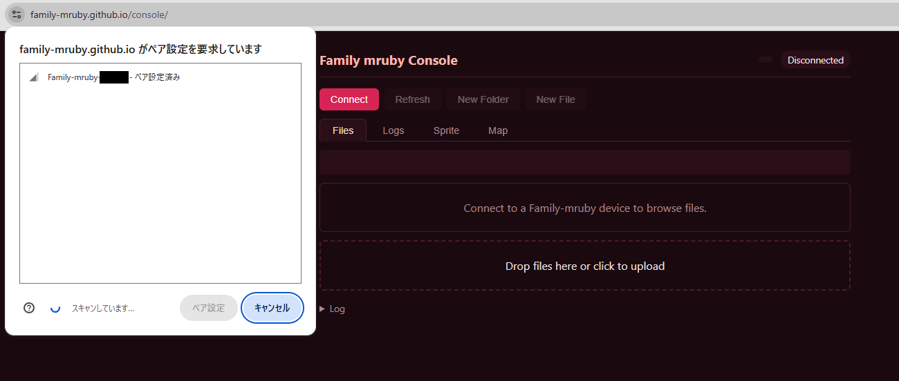
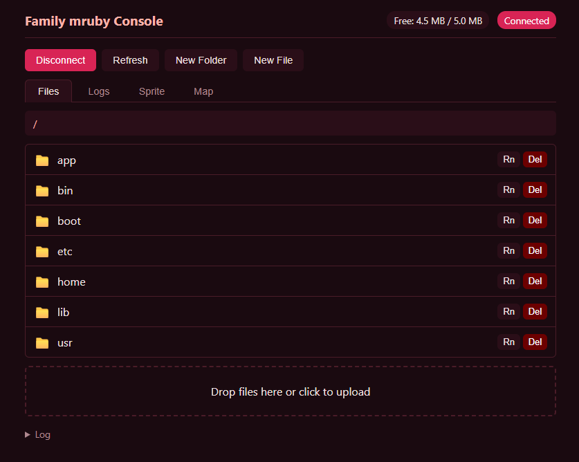
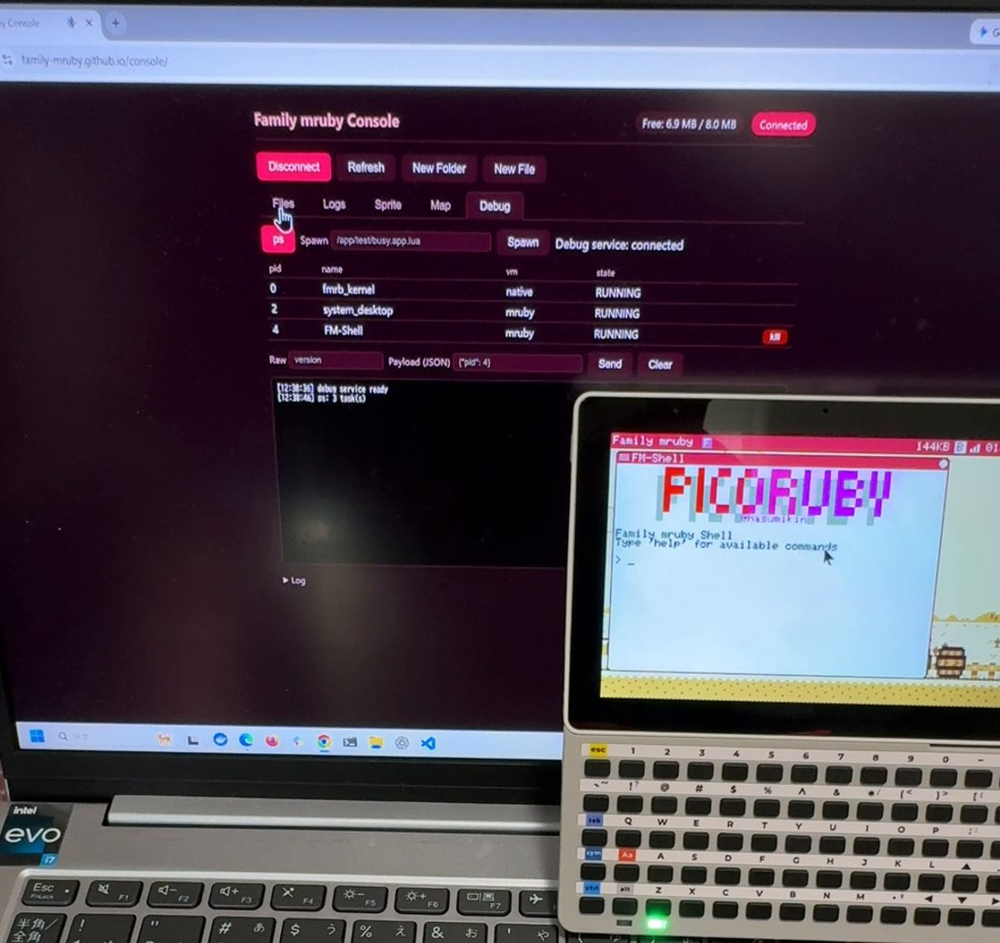

# Family mruby コンソール

BLE で端末に接続する、ブラウザで動くクライアントです。ファイルの転送、ログのリアルタイム表示、
スプライトとタイルマップの編集、デバッグ用の操作ができます。インストールは不要です。

## 必要なもの

- BLE で通信できる PC
- Web Bluetooth に対応したブラウザ (Chrome / Edge)。Firefox / Safari には対応していません

## クライアントの起動

ブラウザで次のアドレスを開きます。

[https://family-mruby.github.io/console/](/console/)

## 接続手順

1. 端末の電源を入れ、起動が終わるまで待ちます (数秒)
2. ブラウザでクライアントを開きます
3. 画面の「Connect」ボタンをクリックします
4. ブラウザの BLE デバイスの選択ダイアログで「Family-mruby-XXXXXX」を選びます
5. 「ペア設定」ボタンを押します (OS によっては「接続」と表示されます)

!!! danger "BLE は電波の届く範囲の誰からでも接続できます"
    端末はペアリングもボンディングも暗号化も行いません。そのおかげで Windows でも Web Bluetooth
    で問題なく接続できるのですが、裏を返せば、接続してくる相手に何も求めないということです。
    電波の届く範囲でブラウザを開いた人なら誰でも、端末のファイルを読み書きし、ログを読み、
    アプリを起動したり止めたりできます。Config の `ble_auto_start` (BLE Auto Start) をオフに
    すれば起動時に BLE を立ち上げないようにできますが、いったん動き出すと再起動するまで
    止められません。[セキュリティ](../limitations.md#セキュリティ) も参照してください。

!!! warning "Windows でうまく接続できない場合"
    Windows の Bluetooth スタックが古いペアリング情報を残していて、接続を妨げることがあります。OS の Bluetooth 設定で既存の `Family-mruby-*` を削除してから、もう一度接続してみてください (この端末はペアリング情報を保持しません)。

## ファイルのアップロード (PC → 端末)

1. クライアントで、置きたい場所のディレクトリに移動します
2. PC のエクスプローラからファイルをブラウザにドラッグ&ドロップします
3. 転送が終わるまで待ちます

## ファイルのダウンロード (端末 → PC)

1. クライアントでファイルを表示します
2. ダウンロードのアイコンをクリックします
3. PC のファイル保存ダイアログで保存先を指定します

## アップロードしたアプリを反映する

アプリのファイル (`.app.rb` / `.app.toml`) を `/app/<dir>/` にアップロードしても、すぐにはランチャーに出ません。次のどちらかで反映できます。

- ランチャーを開いて右クリックします。タイトルバーが「Rescanning...」になり、1〜2 秒で新しいアプリが表示されます
- 端末を再起動します。起動時のスキャンで自動的に読み込まれます

詳しくは [Hello World ▸ ランチャーに反映する](../getting_started/hello_world.md#ランチャーに反映する) を参照してください。

## クライアントでできること

画面上部に 5 つのタブがあります。

| タブ | 用途 |
|---|---|
| Files | フラッシュのファイルシステムを見ます。ドラッグ&ドロップでのアップロード、ダウンロード、名前の変更、ファイルやフォルダの作成・削除ができます |
| Logs | 端末のログをリアルタイムに表示します。部分一致で絞り込めます |
| Sprite | RGB332 のスプライトシートをブラウザで編集して書き戻します |
| Map | タイルマップを編集します |
| Debug | 動いているアプリの一覧 (`ps`)、アプリの終了、パスを指定しての起動、デバッグコマンドの直接送信ができます |

Debug タブは [リモートデバッガ](debugging.md) と同じデバッグ用のサービスにつながっています。
応答しなくなったアプリを止めるだけなら、ブレークポイントもセッションも要らないこのタブが
一番手早い方法です。

## 使える機種

Retro でも Modern でも使えます。Modern では ESP32-C6 が BLE を受け持ちます。

違うのは、同時に何が使えるかです。Modern の C6 は BLE と WiFi を同時に扱えるので、
コンソールと [リモートデスクトップ](remote_desktop.md) を同時に使えます。Retro の ESP32-S3 は
無線が 1 系統なので、BLE と WiFi はどちらか一方だけです。[WiFi につなぐ](../getting_started/wifi.md)
を参照してください。

ヘッドレスの端末 (AtomS3R、StickS3) は、セットアップモードのときだけ BLE を動かします。
WiFi や Asterism の設定はこのときに書き込みます。シミュレータ、Linux 版、ブラウザ版には BLE が
無いので、コンソールからは接続できません。

ブラウザのダイアログに端末がまったく出てこない場合は、BLE が動いていない可能性があります。
Config の `ble_auto_start` を確認するか、システムメニューから手動で起動してください (手動での
起動は Retro のみ)。

## 注意事項

### 大きいファイル

通信速度はあまり速くないので、大きなファイルの転送には時間がかかります。

### 同時接続

同時に接続できるクライアントは 1 つだけです。別のブラウザから接続するときは、先に今の接続を切ってください。

## トラブルシューティング

### 端末が見つからない

- 端末の電源が入っているか確認します
- 端末を再起動して数秒待ちます
- OS 上で別のブラウザやタブが接続していないか確認します

### Connect ボタンが動かない

- Chrome / Edge を使っているか (Firefox / Safari には対応していません)
- HTTPS か `localhost` でクライアントを開いているか

## 関連

- 自作アプリの転送先: [Hello World](../getting_started/hello_world.md)
- ファイルシステムの構成: [ファイル・I/O](../api/filesystem.md)
- 応答しないアプリを止める: [デバッグ](debugging.md)
- 開発ツールの一覧と、それぞれが使える機種: [開発ツール](index.md)
