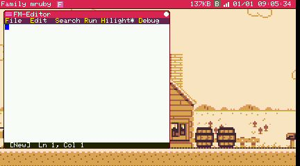

# デバッグ

動いているアプリを止めて中を調べる方法は 2 つあります。端末のエディタに組み込まれたデバッガと、
パソコンから TCP か BLE で接続するリモートデバッガです。

どちらも実機と [シミュレータ](simulator.md) の両方で使えます。ただしエディタのデバッガは、
mruby 版のエディタでビルドしたファームウェアでだけ使えます (下で説明します)。

## 端末だけで: エディタのデバッガ

エディタ (デスクトップで `E`) だけで、パソコンを使わずにデバッグできます。

!!! note "mruby 版のエディタでビルドしたファームウェアだけ"
    Web インストーラで書き込むファームウェアは、エディタを Spinel でビルドしています。この
    エディタにはデバッガが無く、メニューバーにデバッグのメニューも出ません。デバッガを使うには、
    mruby 版のエディタでファームウェアを自分でビルドしてください (`rake build:esp32` や
    `rake build:linux` のコマンドラインに `FMRB_APP_ENGINE_EDITOR=mruby` を付けます)。
    下のリモートデバッガは、どちらのエディタでも使えます。

<div align="center">
  
</div>

### 実行

`F5` で、編集中のファイルをそのまま実行します。保存してから起動し直す必要はありません。

### アタッチ

**Debug** メニューの Attach... で、動いているアプリの一覧が出ます。1 つ選ぶとエディタの画面が
分割され、テキストの下にコールスタックのペインと変数のペインが出ます。

アタッチすると、テキストの左側にブレークポイントを表示する欄 (ガター) が出ます。

| キー | 動作 |
|---|---|
| `F9` | 現在の行のブレークポイントを設定・解除 (アタッチ前でも使えます) |
| `F5` | 実行を再開 |
| `F6` | 一時停止 |
| `F10` | ステップオーバー |
| `F11` | ステップイン |
| `Shift` + `F11` | ステップアウト |
| `F7` / `F8` | コールスタックを上下に移動 |
| `F4` | コールスタックのペインと変数のペインを切り替え |

アタッチしていないときは、いつもどおり `F5` がファイルの実行、`F11` がエディタの全画面表示の
切り替えです。

**Debug** メニューにも同じ操作があります。アタッチ前は Attach... と Toggle BP (ブレークポイントの
設定・解除)、アタッチ中は Continue、Step Over、Step In、Step Out、Pause、Toggle BP、Detach
(デバッグを終了) です。

ブレークポイントはガターに赤い丸で表示され、停止している行は強調表示されます。

!!! note "デバッガは同時に 1 つだけ"
    1 台の端末で同時に持てるデバッグのセッションは 1 つです。エディタがアタッチしている間は
    リモートデバッガからアタッチできず、その逆も同じです。切り替えるときは先にデタッチして
    ください。

## パソコンから: リモートデバッガ

端末ではデバッグ用のサービスが動いていて、msgpack を使ったプロトコルで、次のどちらかの経路で
通信します。

| 経路 | 対象 |
|---|---|
| **TCP** | Linux のビルド。シミュレータはすべてのインタフェースのポート 5555 で待ち受けます ([シミュレータ](simulator.md) の `docker run` に `-p 5555:5555` を加えると、ホストから接続できます)。[Linux 版](../getting_started/linux.md) はポート 5565 を使います。インストールしたパッケージではサービスが止まっていて、有効にしても (`/etc/system_conf.toml` の `debugd = true`) 127.0.0.1 でだけ待ち受けます |
| **BLE** | ESP32 の実機。GATT のサービスを使うので、ケーブルは要りません |

ブラウザ版 ([Family mruby スタジオ](../getting_started/studio.md)) にはデバッグ用のサービスは
ありません。

!!! danger "デバッグ用のサービスに認証はありません"
    どちらの経路も、接続してきた相手を確かめません。リリースのビルドでも同じで、
    [遠隔操作の制限](remote_desktop.md#接続できる相手) の対象外です。シミュレータの TCP は
    すべてのインタフェースで待ち受け、BLE はペアリングも暗号化もしません。端末に届く人なら
    誰でも、動いているアプリにアタッチして変数を読み、アプリを止めたり起動したりできます。
    信頼できる環境で使ってください。[セキュリティ](../limitations.md#セキュリティ) も参照して
    ください。

### コマンドラインのクライアント

fmruby-core リポジトリの `tools/debug/fmrb_dbg_client.py` は、ライブラリとしても、対話的に
使える小さなクライアントとしても使えます。

```bash
# One-shot command
python3 tools/debug/fmrb_dbg_client.py localhost:5555 stack_trace

# Interactive session
python3 tools/debug/fmrb_dbg_client.py localhost:5555

# Over BLE, scanning for a single Family mruby device
python3 tools/debug/fmrb_dbg_client.py ble
```

接続先は、TCP なら `host[:port]` (ポートの既定は 5555)、BLE なら `ble`、近くに複数台ある
ときは `ble:<名前かアドレス>` で指定します。

`msgpack` パッケージが必要です。BLE を使う場合は `bleak` も必要です。

### DAP に対応したエディタから

`tools/debug/fmrb_dap_adapter.py` は、同じクライアントに Debug Adapter Protocol (DAP) の
フロントエンドを付けたものです。VS Code など DAP に対応したエディタや IDE から、動いている
端末に対してブレークポイントを設定し、ステップ実行し、変数を調べられます。

## Web コンソールのデバッグ機能

ブラウザから BLE で端末につなぐ [Web コンソール](console.md) にも、簡単な操作のためのデバッグ
機能があります。動いているアプリの一覧 (`ps`)、アプリの終了、起動ができます。おかしくなった
アプリを止めるだけなら、デバッガのセッションを始めるよりこちらのほうが早く済みます。

## システムが出している情報を読む

ブレークポイントが要る問題ばかりではありません。システムは自分の状態を定期的に出力していて、
多くの場合はその数値を見たほうが早く原因にたどり着けます。

- システムメニューのログ (Log Viewer) で、端末のログを読めます
- 定期的な出力に、各タスクのスタックの残り、VM プールの使用量、描画にかかった時間が出ます
- システムメニューのモニタ (Monitor) で、動いているタスクとメモリの状況がひと目で分かります

メモリ不足になるアプリなら、どのプールがどこまで埋まっているかはこの出力で分かります。
デバッガでは分かりません。

## 関連

- [開発ツール](index.md) — 開発ツールの一覧と、それぞれが使える機種
- [Family mruby コンソール](console.md) — BLE でファイルを送ったり、コマンドを実行したりする
- [リモートデスクトップ](remote_desktop.md) — ブラウザから端末の画面を操作する
- [シミュレータ](simulator.md) — まず Linux 上でシステム全体を動かしてデバッグする
