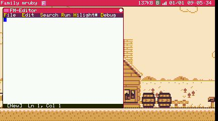

# Debugging

There are two ways to stop a running app and look inside it: the debugger built into the
on-device editor, and a remote debugger your PC drives over TCP or BLE.

Both work on real hardware and in the [simulator](simulator.md); the editor's debugger
needs a firmware built with the mruby editor (below).

## On the device: the editor's debugger

The editor (`E` on the desktop) can debug an app without any PC involved.

!!! note "Only in a firmware built with the mruby editor"
    The firmware the Web Installer writes builds the editor with Spinel, and that editor
    has no debugger: its menu bar has no Debug menu. To use the debugger, build the
    firmware yourself with the mruby editor (`FMRB_APP_ENGINE_EDITOR=mruby` on the
    `rake build:esp32` or `rake build:linux` command line). The remote debugger below works
    either way.

<div align="center">
  
</div>

### Running

`F5` runs the file you are editing. No save-and-launch dance.

### Attaching

**Debug** → Attach... lists the running apps; pick one and the editor splits, showing a
stack pane and a variables pane below the text.

Once attached, a gutter appears down the left side of the text where breakpoints live:

| Key | Action |
|---|---|
| `F9` | Toggle a breakpoint on the current line (works before attaching too) |
| `F5` | Continue |
| `F6` | Pause |
| `F10` | Step over |
| `F11` | Step in |
| `Shift` + `F11` | Step out |
| `F7` / `F8` | Move up and down the call stack |
| `F4` | Switch between the stack pane and the variables pane |

Outside a session `F5` runs the file and `F11` toggles the editor's fullscreen, as usual.

The Debug menu carries the same commands. Before attaching it has Attach... and Toggle BP;
during a session, Continue, Step Over, Step In, Step Out, Pause, Toggle BP and Detach (which
ends the session).

A breakpoint shows as a red dot in the gutter; the line where execution is parked is
highlighted.

!!! note "One debugger at a time"
    A device holds one debug session. If the editor is attached, a remote debugger cannot
    attach as well, and vice versa. Detach before switching.

## From your PC: the remote debugger

The device runs a debug service that speaks a msgpack protocol over one of two transports:

| Transport | Where |
|---|---|
| **TCP** | The Linux builds: the simulator listens on port 5555 on every interface (add `-p 5555:5555` to the `docker run` of the [simulator](simulator.md) to reach it from the host). [The Linux program](../getting_started/linux.md) uses port 5565; its installed package has the service off, and listens on 127.0.0.1 only when it is turned on (`debugd = true` in `/etc/system_conf.toml`) |
| **BLE** | ESP32 hardware, over a GATT service — no cable needed |

The browser version ([Family mruby Studio](../getting_started/studio.md)) has no debug
service.

!!! danger "The debug service has no authentication"
    Neither transport asks who is connecting, in release builds as well: the
    [remote control guard](remote_desktop.md#who-can-connect) does not cover it. The
    simulator's TCP service listens on every interface, and the BLE service uses no pairing
    or encryption. Anyone who can reach the device can attach to a running app, read its
    variables, and stop or start apps. Use it on a network you trust. See
    [Security](../limitations.md#security).

### The command-line client

`tools/debug/fmrb_dbg_client.py` in the fmruby-core repository is both a library and a
small interactive client:

```bash
# One-shot command
python3 tools/debug/fmrb_dbg_client.py localhost:5555 stack_trace

# Interactive session
python3 tools/debug/fmrb_dbg_client.py localhost:5555

# Over BLE, scanning for a single Family mruby device
python3 tools/debug/fmrb_dbg_client.py ble
```

The target is `host[:port]` for TCP (port 5555 by default), or `ble`, or
`ble:<name-or-address>` when more than one device is in range.

It needs the `msgpack` package; BLE additionally needs `bleak`.

### From an editor that speaks DAP

`tools/debug/fmrb_dap_adapter.py` puts a Debug Adapter Protocol front end on the same client,
so an editor that speaks DAP — VS Code, among others — can set breakpoints, step, and
inspect variables against the running device.

## The web console's debug panel

The [web console](console.md), which talks to the device over BLE from a browser, has a
debug panel for the coarse operations: list the running apps (`ps`), kill one, and spawn
another. It is the quickest way to get an app off the device when it is misbehaving,
without reaching for a debugger session.

## Reading what the system says about itself

Not every problem needs a breakpoint. The system prints its own state periodically, and
those numbers usually locate a problem faster:

- **Log Viewer** in the system menu shows the log on the device
- The periodic dump reports each task's remaining stack, the VM pools' occupancy, and
  graphics timings
- `Monitor` in the system menu shows running tasks and memory at a glance

For an app that is running out of memory, that dump tells you which pool and how close it
is, which a debugger will not.

## Related

- [Tools](index.md) — every development tool, and the machines each works on
- [Console](console.md) — moving files and running commands over BLE
- [Remote Desktop](remote_desktop.md) — driving the device's UI from a browser
- [Simulator](simulator.md) — debug the whole system on Linux first
