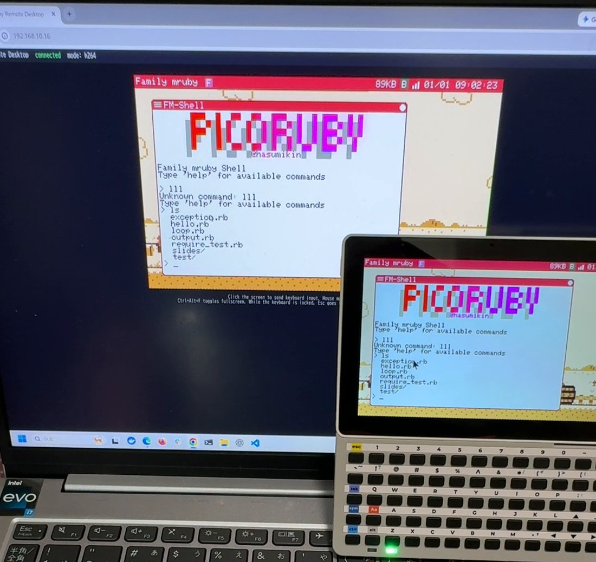

# リモートデスクトップ

**リモートデスクトップは Modern (M5Stack Tab5、P4-Nano) だけで使えます**。WiFi につながっていれば、
端末が自分の画面を配信します。同じネットワークのブラウザで端末のアドレスを開くと、端末の画面が
そのまま映り、パソコンのキーボードとマウスで端末を操作できます。

端末で作業するなら、これが一番速い方法です。普通の大きさのキーボードで入力しながら端末の
動きをそのまま見られますし、スクリーンショットも液晶にカメラを向けずに撮れます。

<div align="center">
  
  <br><em>ブラウザと端末に同じ画面が出ているところ。ステータス表示は <code>connected · mode: h264</code></em>
</div>

## 使い方

1. 先に WiFi につなぎます。[WiFi につなぐ](../getting_started/wifi.md) を参照してください
2. システムメニューの Network でアドレスを確認します
3. Web インストーラで書き込んだファームウェアでは、端末で遠隔操作を許可し、このパソコンを
   登録します。下の [PC の登録 (リリースのビルド)](#pc-の登録-リリースのビルド) を参照してください
4. 同じネットワークにあるパソコンのブラウザで、次のアドレスを開きます

    ```
    http://fmruby.local/
    ```

    mDNS で名前を解決できない環境では、Network ダイアログに出ている IP アドレスを開きます

パソコンに何かをインストールする必要はありません。

ブラウザからの操作は、端末の通常の入力と同じ経路で処理されるので、端末を直接触っているのと
変わりません。`Ctrl` + `Q` や `Ctrl` + `Tab` などのショートカットもそのまま効き、マウスの
ホイールはキーボード入力を受けているウィンドウをスクロールします。

!!! warning "操作するのは 1 人ずつ"
    端末を手に持っている人とブラウザで操作している人は、同じカーソルを動かすことになります。
    ほかの人が端末を使っているかもしれないときは、操作を始める前に声をかけてください。

## 接続できる相手

ファームウェアのビルドの種類によって変わります。

| ビルド | 遠隔操作 |
|---|---|
| **リリースのビルド** (3.1.0 以降に Web インストーラが書き込むもの) | 端末の持ち主が Config で ON にするまで閉じています。ON にしたあとも、登録した PC からしか使えません |
| **開発のビルド** (リポジトリからビルドしたもの。`FMRB_DEV_REMOTE_CTL` が有効、既定で有効) | 開いています。認証はありません |

ここでいう遠隔操作は、このページの機能すべてです。画面 (`/stream`、`/ws_video`)、入力 (`/ws`)、
アプリとファイルのエンドポイント (`/app/...`、`/fs/...`) が含まれます。`/status` は道具が端末を
見つけるのに使うので、どちらのビルドでも開いています。

### PC の登録 (リリースのビルド)

切り替えるのは、Config の **システム** のページにある **遠隔操作** の行です。この行は WiFi に
つながると現れます。左右キーで次のように切り替わります。

| 行の表示 | 意味 |
|---|---|
| `オフ` | 閉じています。`/status` 以外の要求はすべて断ります。既定はこれです |
| `オン` | 登録済みの PC に開いています。オフにするまで、再起動しても残ります |
| `PCを登録 123456` | 開いていて、新しい PC を登録できます。表示中の 6 桁の番号で登録します |
| `登録取消 N PC` | 「保存」を押すと、登録済みの PC をすべて取り消します (オン・オフはそのまま) |

オフにしたときと登録を取り消したときは、開いている接続も切れます。

PC を登録するには、行を `PCを登録` にして、番号が表示されている間に次のどちらかを行います。

- **ブラウザから**: ビューアを開きます。番号を聞かれるので入力すると、受け取ったトークンを
  ブラウザが覚えます。次からは何もしなくてもつながります
- **Ruby の道具から**: 次のコマンドを実行します

    ```
    ruby tools/fmrb_rd_fs.rb <ip> pair <number>
    ```

    トークンは `~/.config/fmrb/` に保存され、`fmrb_rd_*.rb` の各ツールが自動で送ります

登録を受け付けるのは、行に番号が表示されている間だけです。行を離れるか Config を閉じると
終わります。番号を 5 回間違えると行が `PCを登録 (停止中)` になるので、いったん行を離れてから
戻ると新しい番号が出ます。登録できる PC は 4 台までで、5 台目を登録すると一番古い登録が
消えます。

!!! danger "通信は暗号化されていない HTTP です"
    画面、入力、ファイル、そしてトークンそのものも暗号化されずに流れるので、ネットワークを
    のぞける人には中身が読めます。開発のビルドではトークンすらありません。同じネットワークに
    ある機器ならどれでも、アドレスを開いて画面を見たり、操作を送ったり、ファイルを読み書き
    したり、アプリを起動・停止したりできます。あなたの操作と区別する方法はありません。

    信頼できるネットワークでだけ使ってください。インターネットから端末に届くようにルータで
    ポートを転送してはいけません。外から触られたくないときは、遠隔操作をオフにする (リリースの
    ビルド)、下の設定で `enable = false` にする、WiFi を切る、のいずれかを行ってください。
    [セキュリティ](../limitations.md#セキュリティ) も参照してください。

## 設定

`/etc/system_conf.toml` の `[remote_desktop]` で設定します。

```toml
[remote_desktop]
enable = true
mode = "h264"              # "h264" (WebCodecs viewer) or "mjpeg"
fps_cap = 15
jpeg_quality = 80
h264_bitrate_kbps = 1000
h264_gop = 30
```

| 項目 | 意味 |
|---|---|
| `enable` | サーバの有効・無効 |
| `mode` | `h264` は H.264 での配信を試み、使えなければ MJPEG にします。`mjpeg` は常に MJPEG です |
| `fps_cap` | 1 秒あたりのフレーム数の上限。画面が止まっていてもこの一定のレートで送ります (変化のないフレームは数百バイトで済みます) |
| `jpeg_quality` | MJPEG の画質 (0〜100) |
| `h264_bitrate_kbps`, `h264_gop` | H.264 エンコーダの設定 |

## MJPEG と H.264

配信の方式は 2 つあります。MJPEG はどの環境でも動きます。H.264 は通信量が少なくて済みますが、
デコードに使うブラウザの API (WebCodecs の `VideoDecoder`) はセキュアコンテキストでしか使えず、
`http://fmruby.local/` はセキュアコンテキストではありません。LAN 内の HTTP のページでは Chrome
でも `VideoDecoder` が使えないため、ビューアは何も言わずに MJPEG に切り替えます。

どちらで表示しているかは、ビューアのステータス表示 (`mode: mjpeg` / `mode: h264`) で分かります。

普段の作業なら MJPEG で十分です。H.264 を使いたいときは、次のどちらかの方法をとります。

- **Chrome にそのオリジンを信頼させる** (簡単): `chrome://flags/#unsafely-treat-insecure-origin-as-secure`
  を開き、`http://fmruby.local` (と IP アドレス) を入力して Enabled にし、Chrome を再起動します
- **`localhost` 経由で開く** (`localhost` はセキュアコンテキストとして扱われます)

    ```
    socat TCP-LISTEN:8080,fork TCP:<device-ip>:80
    # then open http://localhost:8080/
    ```

端末側で HTTPS を提供する案も検討しましたが、採用しませんでした。端末にかかる TLS の負荷と、
ブラウザに出る証明書の警告が、家庭内のネットワークで使う趣味の端末には見合わないためです。

## 全画面表示

ビューアには、元の縦横比のままモニタいっぱいに表示する全画面モードがあります。端末が送る
ストリームは同じで、ビューアの表示のしかただけが変わります。

## WiFi でファイルとアプリを扱う

同じサーバで、ファイルの転送とアプリの起動もできます。ケーブルもエディタも使わずに、
プログラムを端末に送れます。

```
ruby tools/fmrb_rd_fs.rb <ip> ls    /home
ruby tools/fmrb_rd_fs.rb <ip> put   my.app.rb /app/usr/my.app.rb
ruby tools/fmrb_rd_fs.rb <ip> get   /home/notes.txt
ruby tools/fmrb_rd_fs.rb <ip> pull  /mnt/sd/shots ./shots     # a whole tree
ruby tools/fmrb_rd_fs.rb <ip> push  ./slides /home/slides
```

アドレスだけを渡すと、FTP クライアントのような対話モードになります。端末側とパソコン側で
別々のカレントディレクトリを持ちます (`cd`、`lcd`、`ls`、`get`、`put`、`pull`、`push`、
`cat`、`launch`、`ps`)。

ファイルのエンドポイントで扱える範囲は、ビルドによって違います。

| ビルド | 読み出し | 書き込み・削除・フォルダ作成 |
|---|---|---|
| リリース | `/app`、`/home`、`/usr/share`、`/mnt/sd`。鍵やパスワードを含むファイル (WiFi のパスワードなど) は読み出せません | `/home`、`/app`、`/mnt/sd` |
| 開発 | 鍵も含めてすべてのパス | すべてのパス |

`..` を含むパスはどちらのビルドでも断ります。`pull` と `push` は、反対側に同じサイズのファイルが
あれば転送を省きます。`--force` を付けるとすべて転送します。

開発のビルドなら、書き込み直しの前後で `/home` を簡単に残せます。

```
ruby tools/fmrb_rd_fs.rb <ip> backup ./home-backup     # /home, keys and all
ruby tools/fmrb_rd_fs.rb <ip> restore ./home-backup    # after flashing
```

`backup` は各ファイルを端末側で計算した MD5 と照合し、最後に `manifest.json` を書きます。途中で
止まった場合は、同じディレクトリでもう一度実行すれば続きから取得します。`restore` は内容が違う
ファイルだけを送り、届いたファイルを 1 つずつ確認します。端末にあってバックアップに無いファイルは
一覧に出すだけで、削除はしません。バックアップには WiFi のパスワードやサービスの鍵が入るので、
自分だけが読める場所に置いてください。

`fmrb_rd_launch.rb`、`fmrb_rd_ps.rb`、`fmrb_rd_kill.rb` と組み合わせると、ファームウェアを
書き込み直さずに「送る・起動する・確認する・止める」を繰り返せます。

```
ruby tools/fmrb_rd_fs.rb     <ip> put my.app.rb /app/usr/my.app.rb
ruby tools/fmrb_rd_launch.rb <ip> /app/usr/my.app.rb
ruby tools/fmrb_rd_snap.rb   <ip> out.jpg
ruby tools/fmrb_rd_kill.rb   <ip> <pid>
```

## スクリプトから操作する

同じ道具で画面の操作もできるので、スクリプトや自動テストから端末を動かせます。

```
ruby tools/fmrb_rd_input.rb <ip> click X Y | dclick X Y | key ctrl+tab | wheel N | sleep MS ...
ruby tools/fmrb_rd_snap.rb  <ip> out.jpg
```

座標は、端末が今表示している解像度でのフレームバッファの座標です (Modern では 426 x 240 か
640 x 360。Config の「画面の解像度」の行で選びます)。ビューアのウィンドウの大きさとは関係
ありません。`fmrb_rd_snap.rb` は MJPEG のストリームから 1 フレームを取り出すもので、この
ドキュメントのスクリーンショットもこれで撮っています。

## 仕組み

端末では小さな HTTP サーバが動いています。`GET /stream` が MJPEG のストリーム、`/ws` が入力
イベントをバイナリで運ぶ WebSocket、`/ws_video` が H.264、`/status` が状態を JSON で返します。
アプリのエンドポイントは `POST /app/launch?path=`、`POST /app/kill?pid=`、`GET /app/list`、
ファイルのエンドポイントは `/fs/list`、`/fs/get`、`/fs/put`、`/fs/del`、`/fs/mkdir`、
`GET /fs/md5?path=` (ファイルの MD5 とサイズ。端末側で計算します)、`GET /fs/df` (空き容量) です。
`POST /sys/reboot` で端末を再起動します。リリースのビルドにはさらに `POST /pair` (番号と引き換えに
トークンを発行) と `GET /auth` (トークンが有効かの確認) があり、それ以外のすべての要求で
トークンを求めます。トークンは `X-Fmrb-Token` ヘッダか、クエリの `token=` で渡します。

```
$ curl -s http://fmruby.local/status
{"ip":"192.0.2.16","mode":"mjpeg","streaming":false,"fps":0.0,"kbps":0}
```

フレームのエンコードは P4 のハードウェアで行います。色空間の変換は PPA、H.264 のエンコードは
専用のペリフェラルが担当し、ソフトウェアのループではありません。配信中も端末の動きが極端に
遅くならないのはこのためです。

## Retro では

Retro にはリモートデスクトップがありません。S3 には映像のエンコーダが無く、画面はコンポジット
映像として基板から出力されるためです。その代わり、アプリとファイルのエンドポイントは Retro でも
WiFi がつながれば使えます。`/app/launch`、`/app/kill`、`/app/list` と `/fs` の一式は Modern と
同じように動くので、ケーブルなしでプログラムを送って起動できます。`/stream`、`/ws`、
`/ws_video` はありません。

ビルドごとの決まりも Modern と同じです。リリースのビルドでは、Config の遠隔操作の行で許可して
PC を登録するまで閉じています。開発のビルドでは何も求めません。また Retro は無線が 1 系統
なので、WiFi と BLE はどちらか一方しか使えません。[WiFi につなぐ](../getting_started/wifi.md) を
参照してください。

ヘッドレスの端末 (AtomS3R、StickS3) にも同じエンドポイントがあります。ただし遠隔操作を
オンにする Config が無いので、リリースのビルドではエンドポイントは閉じたままです。

## 関連

- [開発ツール](index.md) — 開発ツールの一覧と、それぞれが使える機種
- [Modern (M5Stack Tab5)](../getting_started/modern.md)
- [ネットワーク](../api/network.md)
- [デバッグ](debugging.md) — 端末に外から入るもう一つの方法
